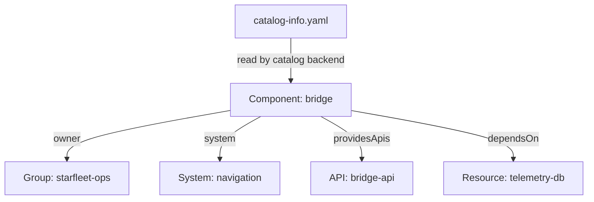

# Entities, Kinds And Entity References

An engineer who joins an incident at night asks three questions. What is this service, who owns it, and what does it depend on? Without a shared record, the answers live in chat history and in the memory of a few people. The Backstage software catalog is that shared record. It stores descriptions of software and of the teams around it as typed records called entities, and it connects them with relationships.

This part explains what an entity is, which kinds exist, how one entity refers to another, and what the catalog does and does not know about a running system.

## What an entity is

An entity is one record in the catalog. Each entity is declared in a YAML file called a descriptor, usually named `catalog-info.yaml`, that lives next to the source code it describes. The catalog backend reads the file and stores the entity. The Backstage frontend then shows it as a page with an owner, links and related entities.

Every entity has the same outer shape, called the envelope. It has an `apiVersion`, a `kind`, a `metadata` object and, for most kinds, a `spec` object. The `kind` says what the entity represents. The `metadata` holds the `name` and optional fields such as `description` and `namespace`. The `spec` holds fields that belong to that kind.

## The kinds the catalog knows

The catalog has built-in kinds. Each one answers a different question.

- `Component` is a piece of software, such as a service, a website or a library. Its `spec.type` says which.
- `API` is an interface that a component provides or consumes. Its `spec.definition` holds the API description.
- `Resource` is infrastructure that a component needs, such as a database or a queue.
- `System` groups components, APIs and resources that work together.
- `Domain` groups systems that belong to one area of the business.
- `Group` is a team or another organizational unit.
- `User` is a person.
- `Location` points to other descriptor files.

The set of kinds decides which questions the catalog can answer. A catalog with only `Component` entities can list services. It cannot say who owns a service, because owners are `Group` entities.

## Entity references

One entity points to another with an entity reference. The full form has three parts: `<kind>:<namespace>/<name>`. For example, `group:default/starfleet-ops` is the group named `starfleet-ops` in the `default` namespace. When you write a reference inside a field that accepts only one kind, you may leave out the kind, and the namespace defaults to `default`. In the `spec.owner` field of a component, `starfleet-ops` and `group:default/starfleet-ops` mean the same thing.

The reference is the identity of an entity. The display title is not. Two entities can have a similar title and still be different because the `name` or the `namespace` differs. If you rename an entity, every reference to the old name stops pointing at it, even if the page looks almost the same.

## Names and namespaces

The `name` must be unique among the entities of one kind in one namespace. The catalog accepts names made of letters and digits separated by `-`, `_` or `.`, with at most 63 characters, and rejects spaces. If you leave out `metadata.namespace`, the catalog uses `default`. Most organizations keep every entity in `default` and use groups and systems to organize them. Namespaces are available when two teams must be able to reuse the same name.

A `kind` also has a version. The `apiVersion` for the built-in kinds is `backstage.io/v1alpha1`. The built-in processors recognize only the versions they know, so a different value stops the catalog from checking and relating the entity. The value is part of the contract and not a free label.

## Try it: list the entities

The playground holds descriptor files for a small estate. The files are stored as ConfigMaps in the `catalog-source` namespace, and a checker pod reads them with the `@backstage/catalog-model` library. The playground does not run the Backstage application. It models the part of the catalog backend that reads locations and checks descriptors.

<!-- astrona:playground:renew -->

Paste this helper once in your terminal. It sends all ConfigMaps to the checker and prints the JSON report through `jq`:

```sh
inspect_catalog() {
  kubectl -n catalog-source get configmap -o json | kubectl -n catalog-tools exec -i deploy/catalog-tools -- node /opt/check/inspect.js | jq "$@"
}
```

Then list the references of every entity the catalog accepts:

```sh
inspect_catalog -r '.summary.ingested[]'
```

The output has eight lines, sorted by text: `api:default/bridge-api`, `component:default/bridge`, `component:default/scout`, `group:default/scout-team`, `group:default/starfleet-ops`, `resource:default/telemetry-db`, `system:default/navigation` and `user:default/kira`. Each line is a full entity reference. Notice that the kind comes first and is written in lower case.

## Read one entity

Look at the `bridge` component as the catalog stores it:

```sh
inspect_catalog '.entities[] | select(.ref == "component:default/bridge") | {ref, spec, annotations: .metadata.annotations}'
```

The `spec` shows `type: service`, `lifecycle: production`, an `owner`, a `system`, one provided API and one dependency. The `annotations` object holds a key the author did not write: `backstage.io/managed-by-location`. The catalog adds it. It records which location the entity came from, so a reader can find the file to edit.



The diagram shows that one descriptor file produces one entity, and the fields in its `spec` name other entities by reference.

## What the catalog does not know

The `bridge` entity says the service depends on `telemetry-db`. That statement is metadata that an author wrote. It does not open a connection to a database, and the catalog does not check that the database exists. The owner field names a group. It does not give that group any permission in Kubernetes, in a cloud account or in a source host. Permissions are set in those systems.

The same holds for health. An entity with `lifecycle: production` is described as a production service. The catalog does not show whether the process is running. A plugin can show live status next to the entity, but that status comes from another system, and the page should make clear which data came from where.

## Common pitfalls

> [!WARNING]
> Do not treat the entity title as its identity: references use kind, namespace and name. Do not assume a `dependsOn` or `owner` field checks anything in a live system. Do not rename an entity without finding the references that use the old name. A catalog entry proves that someone declared the software, not that the software is healthy.
