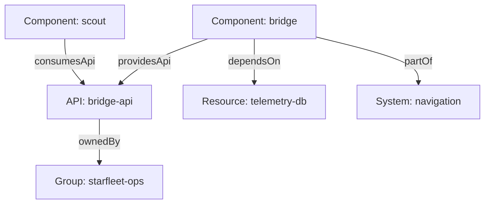

# Ownership And Relationships

A list of entities answers "what exists". Most questions that engineers ask need more: who is responsible, what is this part of, which API does it offer, what breaks if this database goes away. The catalog answers those questions with relations, which are typed, directed links between two entities. This part shows where relations come from, how to read them and how a broken reference appears.

## Relations come from the spec

An author never writes a relation directly. The author writes a field in the `spec`, and the catalog backend derives the relation when it processes the entity. The built-in kinds processor does this work. The `spec.owner` field of a component produces an `ownedBy` relation. The `spec.system` field produces `partOf`. The `spec.providesApis` list produces `providesApi`. The `spec.consumesApis` list produces `consumesApi`. The `spec.dependsOn` list produces `dependsOn`.

Each relation also has a reverse type that the catalog stores on the target entity: `ownedBy` pairs with `ownerOf`, `partOf` with `hasPart`, `providesApi` with `apiProvidedBy`, `consumesApi` with `apiConsumedBy` and `dependsOn` with `dependencyOf`. That is why the page of a group can list the components it owns although the group file never names them.

## Ownership

Every component, API, resource, system and domain should name an owner. The owner is a `Group` entity, or sometimes a `User`. The `owner` field is required for components, APIs, resources, systems and domains. A descriptor without it fails validation, and the entity does not enter the catalog. A descriptor with an owner that does not exist passes validation, because the catalog does not check the target when it validates the file.

Groups form a hierarchy through `spec.parent` and `spec.children`, and users join groups through `spec.memberOf`. A `Group` descriptor must contain `spec.children`, even when the list is empty. These organizational entities are the target of every `ownedBy` relation, so an estate without them has no usable ownership.

## Try it: read the relations

<!-- astrona:playground:renew -->

Define the helper from the playground guide if your terminal is new, then print the relations of the `scout` component:

```sh
inspect_catalog -c '.entities[] | select(.ref == "component:default/scout") | .relations[]'
```

Two lines appear. One is an `ownedBy` relation to `group:default/scout-team`. The other is a `consumesApi` relation to `api:default/bridge-api`. The `scout` descriptor writes `owner: scout-team` and `consumesApis: [bridge-api]` without a kind or a namespace. The catalog adds `group` for an owner, `api` for a consumed API and `default` for the namespace, and the report shows the full result.

Now list every relation that points at the API `bridge-api`:

```sh
inspect_catalog -c '.entities[] | select(.relations[]?.target == "api:default/bridge-api") | {from: .ref, relations: [.relations[] | select(.target == "api:default/bridge-api") | .type]}'
```

The result names `component:default/bridge` with `providesApi` and `component:default/scout` with `consumesApi`. This is how the catalog can show the API page with one provider and its consumers.



The diagram shows that the API has one provider and one consumer, and that the API itself also has an owner.

## Break a reference on purpose

Save this ConfigMap as `repo-scout.yaml`. It changes the owner of `scout` to a group that no descriptor declares:

```yaml
apiVersion: v1
kind: ConfigMap
metadata:
  name: repo-scout
  namespace: catalog-source
data:
  catalog-info.yaml: |
    apiVersion: backstage.io/v1alpha1
    kind: Component
    metadata:
      name: scout
      description: Website that shows scan results
    spec:
      type: website
      lifecycle: experimental
      owner: scout-crew
      consumesApis: [bridge-api]
```

Apply it:

```sh
kubectl apply -f repo-scout.yaml
```

Then list the relations that point at an entity that the catalog does not have:

```sh
inspect_catalog -c '.unresolved[]'
```

The report lists `component:default/scout` with the type `ownedBy` and the target `group:default/scout-crew`. The file is valid and `scout` is still ingested, but its owner does not exist. In the Backstage interface the owner link would not lead to a team page. The error is silent, which is why it stays in catalogs for months.

## Why relations matter more than the entity list

A relation lets an engineer start from any entity and move to the people and software around it. During an incident, the path from a failing component to its owner group and from there to its members is the task the catalog exists for. If the owner field is empty or points at a team that was renamed, that path is broken and the catalog gives no help exactly when it is needed.

Relations also drive ownership views. A system page lists its parts because each component writes `spec.system`. A group page lists what it owns because each entity writes `spec.owner`. If a component forgets `spec.system`, the system page is incomplete and nothing reports an error.

## Common pitfalls

> [!WARNING]
> A valid file can still hold a broken relation: validation checks the shape of a reference, not that the target exists. A `dependsOn` entry needs a kind, for example `resource:default/telemetry-db`; without it the entity fails processing. The `owner` field records responsibility only and gives no permission. Write the full reference when two kinds could share a name.
