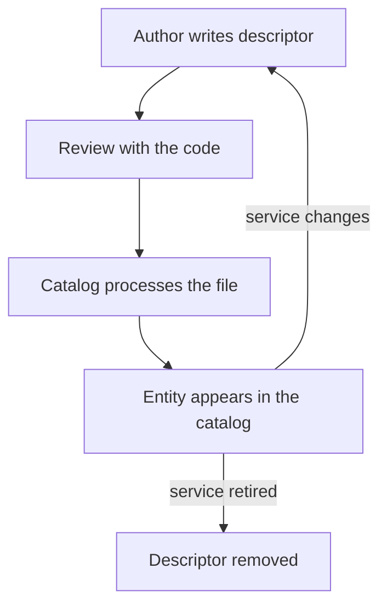

# Source Of Truth, Freshness And Adoption

A catalog is only as useful as its data. Entities can be correct on the day they are written and wrong a year later. Two files can claim the same entity. A team can use the catalog for months without improving a single task. This part covers who owns each piece of catalog data, how stale data appears, and how to judge whether the catalog helps.

## Where descriptors live

Most organizations keep each descriptor in the same repository as the software it describes. The file changes in the same pull request as the code, the same reviewers see it, and the history shows who changed it and why. This is the default model of Backstage: the catalog reads files, it does not become the place where people edit them.

Some data does not belong next to code. The list of groups and users usually comes from an organization directory, such as an identity provider. An entity provider can read that directory and create `Group` and `User` entities, so people do not type team lists by hand. Infrastructure inventories can feed `Resource` entities in the same way. In each case one system is the source of truth for one kind of fact, and the catalog is a read-only view of it.

## One entity, one source

Two sources must not produce the same entity reference. If a static location and an automated provider both emit `component:default/bridge`, the catalog sees a conflict and keeps only one of them. Which one wins depends on processing order, so the result looks random. The fix is to decide which source owns each kind of entity, and to remove the other.

## Try it: see a conflict

The playground holds one repository per service. Add a second repository that declares the same component as `bridge`.

<!-- astrona:playground:renew -->

Save this as `repo-bridge-copy.yaml`:

```yaml
apiVersion: v1
kind: ConfigMap
metadata:
  name: repo-bridge-copy
  namespace: catalog-source
data:
  catalog-info.yaml: |
    apiVersion: backstage.io/v1alpha1
    kind: Component
    metadata:
      name: bridge
      description: A second descriptor for the same component
    spec:
      type: service
      lifecycle: experimental
      owner: scout-team
```

Apply it:

```sh
kubectl apply -f repo-bridge-copy.yaml
```

The file exists but nothing reads it yet, because the catalog only reads locations it is configured to read. Open the catalog configuration, add a location for the new file, and look at the result. First print the current location list:

```sh
kubectl -n catalog-source get configmap catalog-config -o jsonpath='{.data.app-config\.yaml}'
```

Add this line under `locations:` in a local copy named `app-config.yaml`, using the same indentation as the other entries: `- type: url` with the target `https://git.starfleet.example/bridge-copy/blob/main/catalog-info.yaml`. Then replace the ConfigMap data:

```sh
kubectl -n catalog-source create configmap catalog-config --from-file=app-config.yaml --dry-run=client -o yaml | kubectl apply -f -
```

Print the conflicts:

```sh
inspect_catalog -c '.conflicts'
```

The report lists the reference `component:default/bridge` with both file locations. In the model the first location that claims the entity keeps it, and the second is not ingested. A real catalog reports the conflict as an error on the later location and keeps the entity from the first one. Delete the second location from the configuration to clear it.

## How data goes stale

A descriptor can be valid and still wrong. The owner group was renamed, the service was retired, the repository moved. Processing success only says that the file passed the contracts: the envelope is correct, the kind is known, the references are well formed. It does not say that the facts are current.

Staleness appears in a few repeatable ways: owners that point at groups that no longer exist, components with `lifecycle: production` whose repositories have been archived, and descriptors nobody has changed in a long time. Keeping data fresh is an operating task. Teams review their own descriptors when they change the code. The organization checks for unresolved owners and for entities without an owner, and a retired service gets `lifecycle: deprecated` and then its descriptor is removed.



The diagram shows that accuracy depends on a loop between the code and the descriptor, and processing is only one step in that loop.

## Live data next to catalog data

A plugin can show information from another system on an entity page, for example a deployment status or a build result. That information comes from the other system and is current when the plugin reads it. The catalog fields next to it are what an author wrote earlier. A reader should know which is which, so an interface should not suggest that the catalog confirms a healthy deployment.

## Judge adoption by tasks

Counting entities measures effort, not value. A better test is a list of real tasks. Can an engineer find the owner of any service in under a minute during an incident? Can a team list the APIs it consumes and the teams that provide them? Can a new engineer find which components belong to a system? When a task fails, the cause is usually specific: missing owners, missing `system` fields, or a team list that is out of date. Fix those first, because they improve the answers the catalog gives most often.

## Common pitfalls

> [!WARNING]
> Do not let two sources create the same entity reference. Do not read a clean ingestion result as proof that the data is correct. Do not mix live status and descriptor data in one view without saying where each comes from. Do not measure success by the number of entities.
