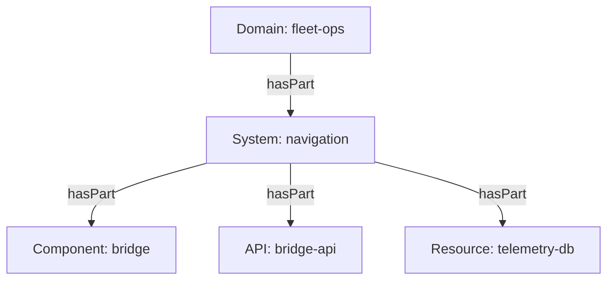

# Systems, Domains, APIs And Resources

A catalog that lists only components shows software as a flat list. People ask larger questions: which services form the navigation product, which API does the `scout` website call, which database does the `bridge` service need. The kinds `Domain`, `System`, `API` and `Resource` answer these questions. This part shows what each kind holds, which fields connect them and how to read the connections in the playground.

## How the kinds group software

A `System` is a set of components, APIs and resources that one team or a few teams maintain as one product. A `Domain` is a set of systems that belong to one business area. The grouping goes upward through fields in the `spec`. A component, an API or a resource names its system in `spec.system`. A system names its domain in `spec.domain`. Each of these fields produces a `partOf` relation when the catalog backend processes the entity.

The `System` and the `Domain` entity both require `spec.owner`. The `domain` field of a system is optional, and a system without a domain is valid. A `Component` requires `spec.type`, `spec.lifecycle` and `spec.owner`. An `API` requires `spec.type`, `spec.lifecycle`, `spec.owner` and `spec.definition`. A `Resource` requires `spec.type` and `spec.owner`. A resource describes infrastructure that a component needs, for example a database or a storage bucket.



The diagram shows the grouping from the point of view of the parent. The descriptors of the children write the `partOf` direction, and the catalog stores the `hasPart` direction on the parent.

## Connecting components through APIs

A component that offers an API lists it in `spec.providesApis`. A component that calls an API lists it in `spec.consumesApis`. Both fields hold entity references, and the default kind is `API`. A component that needs a database or another component lists it in `spec.dependsOn`. A `dependsOn` reference must include the kind, because the target can be a component or a resource, for example `resource:default/telemetry-db`.

Together these fields give an engineer an impact answer without reading code. If the owner of `bridge-api` changes its definition, every component that has an `apiConsumedBy` relation to it is affected. If `telemetry-db` goes offline, every component that has `dependencyOf` pointing at it is affected. The catalog stores those reverse relations itself, and the checker in the playground prints only the relations that the descriptors write.

<!-- astrona:playground:renew -->

The playground estate has the system `navigation`, the component `bridge`, the API `bridge-api`, the resource `telemetry-db` and the component `scout`. Paste the helper function once:

```sh
inspect_catalog() {
  kubectl -n catalog-source get configmap -o json | kubectl -n catalog-tools exec -i deploy/catalog-tools -- node /opt/check/inspect.js | jq "$@"
}
```

Print the relations of `bridge` and `scout`:

```sh
inspect_catalog -c '.entities[] | select(.ref == "component:default/bridge" or .ref == "component:default/scout") | {ref, relations}'
```

The relations of `bridge` include `partOf` with the target `system:default/navigation`, `providesApi` with the target `api:default/bridge-api` and `dependsOn` with the target `resource:default/telemetry-db`. The relations of `scout` include `consumesApi` with the target `api:default/bridge-api`. The checker derives them from the `spec` fields in the same way as the catalog backend.

## Add a domain

The system `navigation` has no domain yet. Save the text of the file in the repository `bridge`:

```sh
kubectl -n catalog-source get configmap repo-bridge -o jsonpath='{.data.catalog-info\.yaml}' > catalog-info.yaml
```

Add the line `domain: fleet-ops` under `owner: starfleet-ops` in the `System` document of `catalog-info.yaml`. Then save the new `Domain` document as `domain.yaml`:

```yaml
apiVersion: backstage.io/v1alpha1
kind: Domain
metadata:
  name: fleet-ops
  description: Everything that moves the fleet
spec:
  owner: starfleet-ops
```

Append it to the descriptor file with a document separator and write the file back to the ConfigMap:

```sh
printf -- '---\n' >> catalog-info.yaml
cat domain.yaml >> catalog-info.yaml
kubectl -n catalog-source patch configmap repo-bridge --type merge -p "$(jq -n --rawfile text catalog-info.yaml '{data: {"catalog-info.yaml": $text}}')"
```

Then check the result:

```sh
inspect_catalog -c '.entities[] | select(.ref == "system:default/navigation") | .relations'
inspect_catalog -c '.summary.ingested'
```

The system now has a `partOf` relation to `domain:default/fleet-ops`, and the domain is in the list of ingested entities. Remove the `domain` line and the extra document if you want to restore the estate.

## Reading an unresolved reference

Change `domain: fleet-ops` to `domain: fleet-operations` in the system, without changing the `Domain` document. The report stays valid, because validation does not check targets. Print `.unresolved[]` and find the entry for `partOf` with the target `domain:default/fleet-operations`. The reference points at an entity that does not exist, so the system page would show a link to nothing.

## What you now know

You can place a component in a system and a domain, and you can connect components through the APIs they provide and consume and through their dependencies. You can read each connection as a relation in the report. The open question is how fresh this data stays when the source changes, which depends on the descriptors, not on the kinds.

## Common pitfalls

> [!WARNING]
> A `dependsOn` reference without a kind can fail or point at the wrong entity, so write `resource:default/telemetry-db`. A system without an owner fails validation, but a system whose `domain` names a missing domain passes validation and leaves an unresolved relation. An `API` needs a `definition`, and the file does not need to be valid OpenAPI for the catalog to accept it.
