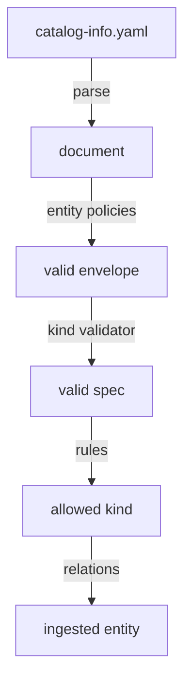

# Descriptor Envelope, Names And Entity Policies

A catalog is only as useful as the entities it contains. Every entity starts as a text file in a repository, and the catalog accepts that text only if it passes a series of checks. When a check fails, the entity does not appear, and the author often sees no error in the place where they work. This chapter explains the shape of a descriptor, the formats that each field must follow and the part of the catalog that enforces them, so that you can read a rejection and fix it.

A descriptor is a YAML file, usually named `catalog-info.yaml`, that declares one or more software entities. An entity is one record in the catalog, such as a service, an API or a team. The catalog backend is the server process of Backstage that reads descriptors and stores entities. The playground for this module does not run that backend. It runs a small checker that applies the same validation library, `@backstage/catalog-model`, to the descriptor files, and it models the other steps.

## The envelope

Every descriptor document has the same outer shape, called the envelope. It has four top-level fields. `apiVersion` names the version of the format and is `backstage.io/v1alpha1` for the built-in kinds. `kind` says what the entity represents, for example `Component`. `metadata` holds the identity and the descriptive fields. `spec` holds the fields that belong to the kind.

The catalog reads the `apiVersion` and the `kind` first, because together they decide which kind validator checks the `spec`. If the pair is not known, no validator can accept the entity. For that reason the `apiVersion` is part of the contract and not a free label.

The envelope also allows an optional `relations` field and an optional `status` field. Both are filled in by the catalog itself, so an author does not write them. Any other field at the top level is a foreign root field and the catalog refuses the document. A typical mistake is a field such as `owner: team-a` written at the top level instead of inside `spec`.

## The metadata fields

The `metadata.name` field is required. It identifies the entity inside its kind and namespace. A name is made of letters and digits, and the parts can be separated by `-`, `_` or `.`. It has at most 63 characters and must begin and end with a letter or a digit. A space is not allowed. The name `probe collector` is invalid and `probe-collector` is valid.

The `metadata.namespace` field is optional and defaults to `default`. A namespace uses letters and digits with `-` as the only separator, so an underscore is invalid. Most organizations keep every entity in `default`.

The other fields are optional and have their own formats:

- `title` is a short display name. It does not identify the entity.
- `description` is a short text for readers.
- `labels` is a map of string keys and string values that the catalog can filter on. A label key has an optional lowercase domain prefix, a `/` and a name part. The name part follows the rules of `name`, so the key `bad key` is invalid. The prefix `backstage.io/` is reserved.
- `annotations` is a map of string keys to string values. Key format is the same as for labels. A value can be any string of any length.
- `tags` is a list of short strings. A tag uses lowercase letters, digits and the characters `:`, `+` and `#`, separated by `-`, with at most 63 characters.

Names are compared without regard to case, so `Bridge` and `bridge` are the same name for the same kind and namespace. That is why a reference to an entity is written in lower case in reports.

## Entity policies

An entity policy is a check that the catalog applies to every document before it accepts the entity. The catalog model library provides four policies that run together:

1. The schema policy checks that `apiVersion`, `kind` and `metadata.name` exist and have the right types.
2. The namespace policy fills in `default` when `metadata.namespace` is missing.
3. The foreign root fields policy refuses fields at the top level that the envelope does not define.
4. The field format policy checks the format of the name, namespace, labels, annotations and tags that this chapter listed.

A document that fails one of these policies is refused, and the catalog records the error for that entity. The playground report shows these errors with the stage `policy`.



The diagram shows the order of the checks in the playground model: a document must pass the entity policies before its `spec` is checked, and it must pass all checks to become an ingested entity.

## Try it: read a policy error

The playground holds a few descriptor repositories as ConfigMaps in the namespace `catalog-source`. The repository `probe` has a file with an invalid name.

<!-- astrona:playground:renew -->

Paste this helper once in your terminal. It sends all ConfigMaps to the checker pod and prints the JSON report through `jq`:

```sh
inspect_catalog() {
  kubectl -n catalog-source get configmap -o json | kubectl -n catalog-tools exec -i deploy/catalog-tools -- node /opt/check/inspect.js | jq "$@"
}
```

List the errors that have the stage `policy`:

```sh
inspect_catalog -c '.errors[] | select(.stage == "policy") | {entity, message}'
```

One error appears for the entity `component:default/probe collector`. The message says that `metadata.name` is not valid, repeats the format rule (sequences of `[a-zA-Z0-9]` separated by any of `-_.`) and shows the value that it found, `probe collector`. The report names the entity with its declared name, because the entity has no valid reference yet.

Now fix it. Save the descriptor file of the `probe` repository on your machine:

```sh
kubectl -n catalog-source get configmap repo-probe -o jsonpath='{.data.catalog-info\.yaml}' > catalog-info.yaml
```

Open `catalog-info.yaml` in a text editor and change `name: probe collector` to `name: probe-collector`. Do not change anything else. Then write the file back. The command replaces the key `catalog-info.yaml` of the ConfigMap:

```sh
kubectl -n catalog-source create configmap repo-probe --from-file=catalog-info.yaml --dry-run=client -o yaml | kubectl apply -f -
```

Check that the entity is now accepted:

```sh
inspect_catalog -r '.summary.ingested[]' | grep probe
```

The list now contains `component:default/probe-collector` and `component:default/probe-display`. The `probe-relay` entity is still missing because it has a different fault, one that the entity policies do not check.

## What a policy error does not tell you

A policy error says that the format of a field is wrong. It does not say whether the entity would be useful, whether its owner exists or whether its kind is allowed. A document can pass every entity policy and still fail later checks. Other checks look at the kind-specific `spec` and at the rules of the catalog.

A policy error also names the exact field. The message in the report contains the field path, such as `metadata.name` or `labels.bad key`, so the first step of a diagnosis is always to read that path and compare it with the format rule.

## Common pitfalls

> [!WARNING]
> Do not rename an entity casually: references from other entities use the name, so a rename breaks them. Do not write ownership or other `spec` fields at the top level of the document, because the catalog refuses foreign root fields. Do not put credentials or tokens in a descriptor, because the file is readable by everyone who can read the repository. Remember that a label key and an annotation key follow the same format rules as a name, so spaces are never allowed.
