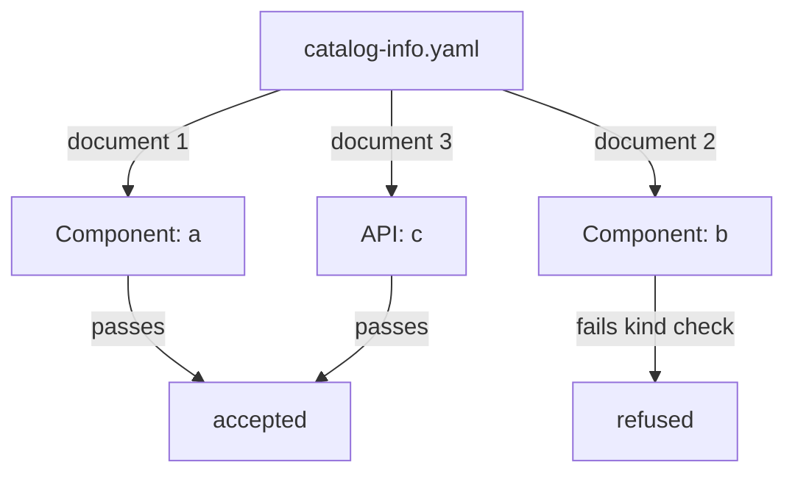

# Kinds, Required Fields And Multi-Document Files

A descriptor can have a perfect envelope and still be refused, because each kind has its own required fields. A Component without a lifecycle is not a complete description of a component, and the catalog treats it as invalid. This chapter explains how the kind decides which `spec` fields are required, how one file can declare many entities, and how the catalog treats a file in which only some documents are wrong.

The problem it solves is practical. Teams keep one `catalog-info.yaml` per repository and often put several entities in it. When one of them fails, the author needs to know which one, why, and whether the others were affected.

## The kind decides the required fields

The `kind` field selects a validator. A kind validator is a piece of code of the catalog model that checks the `spec` of one kind against a schema. The built-in kinds and their required `spec` fields are these:

- `Component` requires `type`, `lifecycle` and `owner`.
- `API` requires `type`, `lifecycle`, `owner` and `definition`.
- `Resource` requires `type` and `owner`.
- `System` requires `owner`.
- `Domain` requires `owner`.
- `Group` requires `type` and `children`. The `children` list can be empty, but the field must exist.
- `User` requires `memberOf`. The list can be empty.
- `Location` has no required field, so an empty `spec` is valid. It normally carries `target` or `targets`.

The values have meaning too. For a Component, `type` says what the software is, for example `service` or `website`, and `lifecycle` says its stage, for example `experimental` or `production`. The `owner` is an entity reference to the Group or User that is responsible. The validator checks that the owner is a non-empty string. It does not check that the owner exists. That check belongs to the relation step.

A common surprise is the `Group` kind. A team with no sub-teams still needs `children: []`, because the validator requires the field. A Group without `children` never enters the catalog.

## Multi-document files

YAML allows several documents in one file. A line that contains only `---` ends one document and starts the next. The catalog reads each document as a separate entity, so one `catalog-info.yaml` can declare a System, a Component and an API together. Each document has its own envelope and its own `spec`.

Every document is checked on its own. If the second document of three fails the kind validator, the first and the third can still be accepted. The report of the playground shows this: the file in the `probe` repository has three Components and only two of them are faulty.

This independence has a limit. A YAML syntax error is a different kind of failure. If the indentation of a document is wrong, the text cannot be turned into an object at all. The parser reports a parse error, and that error has no entity name because there is no entity. The other documents of the file are still read separately in the playground model. In every case the author must fix the text of the broken document.



The diagram shows that the documents of one file are checked one by one, so one refused document does not stop the other two from being accepted.

## The stages in the report

The playground report gives every error a stage. This helps you decide where to look.

- `parse` means the YAML text could not be read. The error has no entity.
- `policy` means the envelope or a metadata format is wrong.
- `kind` means a `spec` field is missing or has the wrong type for the kind.
- `rules` means the document is valid but its kind is not allowed by the catalog rules.
- `relations` means a reference inside the document cannot be turned into a valid entity reference.

Always fix the earliest stage first. A document with a policy error never reaches the kind validator, so fixing the `spec` of that document before the name changes nothing.

## Try it: fix a missing required field

The `probe` repository has a Component named `probe-relay` without a lifecycle. Read all errors that have the stage `kind`.

<!-- astrona:playground:renew -->

Paste the helper from the playground guide if your terminal is new:

```sh
inspect_catalog() {
  kubectl -n catalog-source get configmap -o json | kubectl -n catalog-tools exec -i deploy/catalog-tools -- node /opt/check/inspect.js | jq "$@"
}
```

Then list the errors:

```sh
inspect_catalog -c '.errors[] | select(.stage == "kind") | {entity, message}'
```

The message names the entity `component:default/probe-relay` and says that `/spec` must have the required property `lifecycle`. The path starts at the `spec` object, so the missing field is directly inside it.

Now check the state of every document of the `probe` file. This query prints the declared reference, whether the document is valid and whether the catalog ingested it:

```sh
inspect_catalog -c '.entities[] | select(.location | contains("/probe/")) | {declared, valid, ingested}'
```

The three documents appear. `probe-display` is valid and ingested, even though its neighbour is not. That shows that the documents of one file are independent.

Save the descriptor file, add `lifecycle: production` under `spec` of `probe-relay` with a text editor, and write it back:

```sh
kubectl -n catalog-source get configmap repo-probe -o jsonpath='{.data.catalog-info\.yaml}' > catalog-info.yaml
```

After the edit, apply the file:

```sh
kubectl -n catalog-source create configmap repo-probe --from-file=catalog-info.yaml --dry-run=client -o yaml | kubectl apply -f -
```

Check the result with the first query again. The `kind` error for `probe-relay` is gone, and the entity is listed in `.summary.ingested`.

## Validation is not a relation check

`probe-relay` names `starfleet-ops` as its owner. The `kind` validator accepted that value because it is a string. The catalog resolves the reference later, when it processes relations. If no Group named `starfleet-ops` was accepted, the entity would still be ingested, but its `ownedBy` relation would point at a missing entity. The report lists such links in `.unresolved`.

This split matters when you diagnose. A required field that is missing is a validation failure and the entity is absent. An owner that does not exist is a relation failure and the entity is present, but its page shows an owner that cannot be opened.

## Common pitfalls

> [!WARNING]
> Do not assume `children` is optional on a Group or `memberOf` on a User: both are required, and an empty list is valid. Do not read one refused document as a failure of the whole file, because the other documents are checked on their own. Do not expect the validator to check that an owner exists. Do not fix a `spec` before you have read the stage of the error: a `policy` error comes first and hides the later checks.
