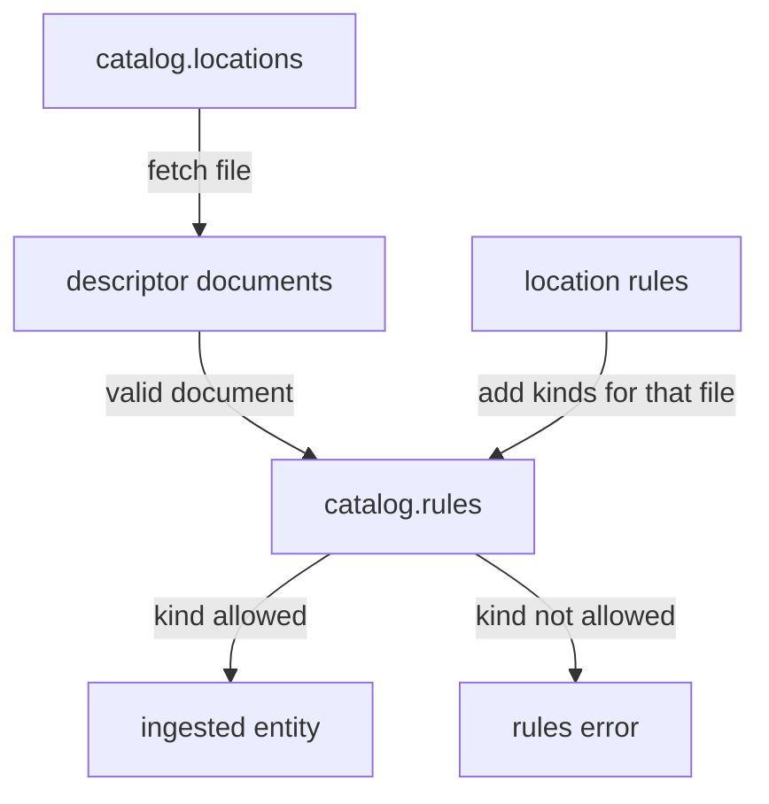

# Catalog Rules And Registering Locations

A valid descriptor still does nothing until the catalog knows where to find it, and a valid entity is still refused if its kind is not allowed. These are two separate gates. The first gate is a location: a pointer to a descriptor file. The second gate is a rule: a statement of which kinds the catalog accepts from which source. This chapter explains both, because a missing entity is most often caused by one of them and not by the content of the file.

## Locations and registration

A location is a reference to a descriptor file. It has a `type`, which says how to read the file, and a `target`, which says where the file is. The type `url` means that the catalog backend fetches the file from a URL with the reader of an integration, for example the GitHub integration. The type `file` reads from the local disk of the backend and is meant for development only.

Registering a location means telling the catalog about it. There are three ways. The first is static configuration: the `catalog.locations` list in `app-config.yaml`. The second is the interface or the catalog API: a user pastes a URL, and the catalog stores a location record in its database. The third is another entity: a `Location` entity inside a descriptor lists more targets, and the catalog follows them.

A location that is registered in static configuration cannot be removed through the catalog API. The author must remove it from the configuration. The setting `catalog.readonly: true` turns off registration and removal through the API, so then only configuration and automated sources add entities.

Registering a location does not create an entity. After registration the catalog still has to read the file, validate each document and check the rules. A location can be registered and have no accepted entity at all. The report of the playground shows this as a location with a status next to a list of errors.

In the playground, the target of a location has a fixed shape. The URL `https://git.starfleet.example/probe/blob/main/catalog-info.yaml` points to the file `catalog-info.yaml` in the ConfigMap `repo-probe`, on the branch `main`. A URL that points at a missing file gets the status `not-found`.

## Catalog rules

A catalog rule limits which kinds the catalog accepts. The key `catalog.rules` is a list. Each item has an `allow` list of kinds, for example `- allow: [Component, API, Location]`. When the key is missing, the catalog uses a default list that allows the common software kinds such as `Component`, `API` and `Location`. The kinds that describe an organization, `Group` and `User`, are not in the default list.

When the key `catalog.rules` is present, its list replaces the default list. A list that names only `Component` makes every other kind invalid. This is a frequent cause of missing entities after someone adds `catalog.rules` to allow one more kind and forgets the kinds that were already allowed.

A rule can also belong to one location. A location entry in `catalog.locations` can have its own `rules` list. That list allows extra kinds for the file of that location only. For example, an organization file that holds `Group` and `User` entities can allow them for itself and keep the global list short. A `Group` declared in any other file is still refused. This is the safer design because a team cannot add a group to the catalog by writing it in its own repository.

A rule is checked after the document is valid. That is why the stage of its error is `rules`: the entity itself is fine, and the catalog refuses it because of policy of the installation.



The diagram shows that the global rules and the rules of one location decide together whether a valid document becomes an entity.

## Try it: register a location and test a rule

The playground has a repository `shuttle` with a valid Component, and no location points at it.

<!-- astrona:playground:renew -->

Paste the helper if your terminal is new:

```sh
inspect_catalog() {
  kubectl -n catalog-source get configmap -o json | kubectl -n catalog-tools exec -i deploy/catalog-tools -- node /opt/check/inspect.js | jq "$@"
}
```

List the configured locations and their status:

```sh
inspect_catalog -c '.locations[] | {target, status}'
```

Four locations appear and none of them is the `shuttle` repository, so the entity `component:default/shuttle` is not in the list from `.summary.ingested`. Save the configuration key of the catalog:

```sh
kubectl -n catalog-source get configmap catalog-config -o jsonpath='{.data.app-config\.yaml}' > app-config.yaml
```

Open `app-config.yaml` and add this item at the end of the `locations` list, with the same indentation as the other items:

```yaml
- type: url
  target: https://git.starfleet.example/shuttle/blob/main/catalog-info.yaml
```

Write the file back:

```sh
kubectl -n catalog-source create configmap catalog-config --from-file=app-config.yaml --dry-run=client -o yaml | kubectl apply -f -
```

Run the first query again. The `shuttle` location now has the status `ok` and the entity is ingested. Its `dependsOn` reference to `component:default/bridge` resolves, because that Component is accepted.

Now test a rule. In `app-config.yaml`, change the rule of the organization location from `allow: [Group, User]` to `allow: [User]` and apply the file again with the same command. Then list the errors with the stage `rules`:

```sh
inspect_catalog -c '.errors[] | select(.stage == "rules") | {entity, message}'
```

The two Groups `starfleet-ops` and `scout-team` appear with a message that says their kind is not allowed from the location. They are valid documents. The rule alone refuses them, and the Components that name them as owner now have unresolved `ownedBy` relations. Restore `allow: [Group, User]` and apply the file again before you continue.

## Locations that point at other files

A `Location` entity is a descriptor document with `kind: Location`. Its `spec.target` or `spec.targets` lists more files. The catalog reads these files only if the `Location` entity itself is accepted, so the kind `Location` must be allowed by the rules. A relative target such as `./teams.yaml` is resolved against the file that contains the entity.

## Common pitfalls

> [!WARNING]
> Do not assume that registering a location creates entities: the file must still be found, valid and allowed. Do not add `catalog.rules` to allow one kind without listing the kinds that were allowed before, because the list replaces the default. Do not allow `Group` for every source when one organization file needs it. A `not-found` location usually means the URL, the file name or the branch does not match the source, and it does not mean that the descriptor is invalid.
