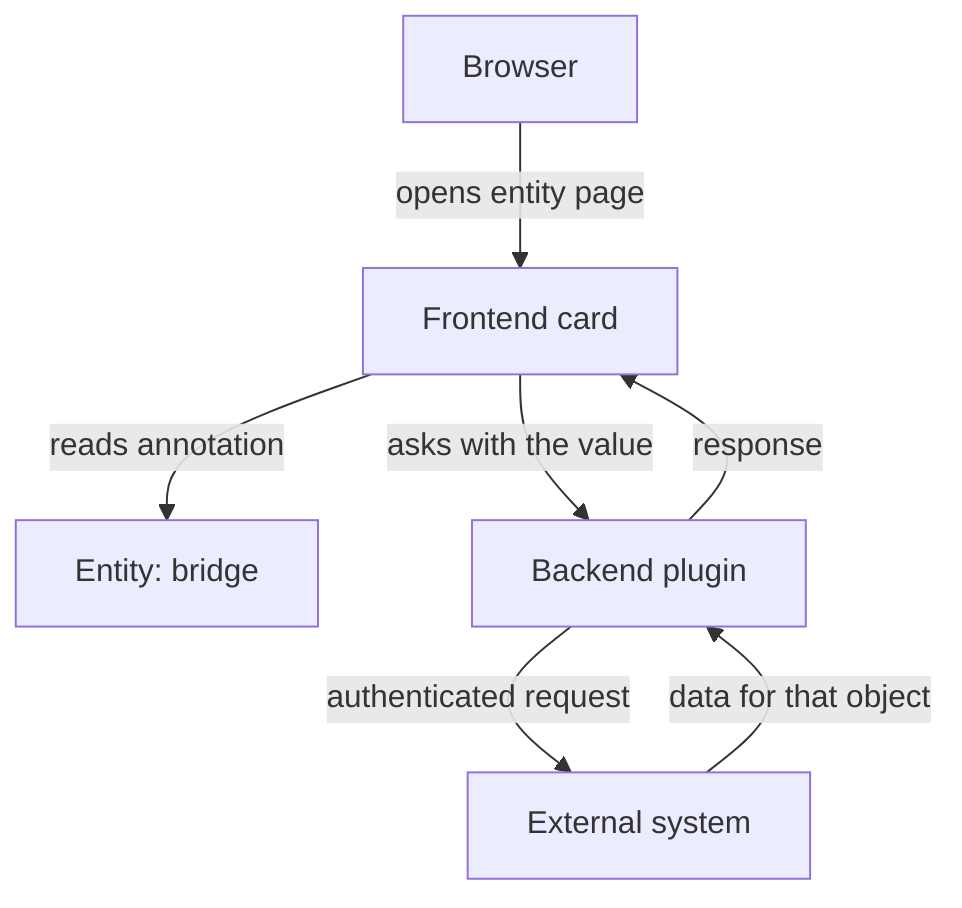

# Annotation Contracts And External Identity Mapping

A catalog entity describes a piece of software, but the software lives in many other systems: a source repository, a documentation site, a build service, a Kubernetes cluster, a paging tool. The catalog does not copy data from those systems. It stores a short pointer to each one. That pointer is an annotation. This part explains what an annotation is, how a plugin turns it into a request to an external system, and why a pointer can be well formed and still wrong.

## What an annotation is

An annotation is one entry in the `metadata.annotations` map of an entity. The key is a name and the value is a string. The key names a contract, which is an agreement about what the value means. For example, the key `github.com/project-slug` is an agreement that the value is `<owner>/<repository>` and names a GitHub repository.

The YAML file does not say what the key means. Meaning comes from the code that reads the key. That code is a frontend plugin (a card or a tab in the Backstage web application), a backend plugin that serves data to that card, or a catalog processor (code in the catalog backend that reads and changes entities while it ingests them). If no installed code reads a key, the annotation is stored and shown in the raw entity, and nothing else happens.

Here is the first real example. The `bridge` descriptor in the playground has this metadata:

```yaml
metadata:
  name: bridge
  annotations:
    backstage.io/techdocs-ref: dir:.
    github.com/project-slug: starfleet-org/bridge
    backstage.io/kubernetes-id: bridge
```

The first key tells the documentation plugin where the documentation source is. The second tells the GitHub plugins which repository to ask about. The third tells the Kubernetes plugin which workloads belong to this component. Three keys, three different consumers, one entity.

## How a plugin uses the value

A plugin does not search the catalog for the right repository. It receives an entity, reads one named annotation and uses the string. The flow for a build-status card looks like this.



The diagram shows that the annotation value is only an identifier: the backend plugin uses its own credential to call the external system, and the card shows whatever comes back.

Notice what the catalog does in this flow: it only stores the string. It does not check that the repository exists, that the value has the right shape for the plugin, or that the object belongs to this component. Those checks, if any, belong to the plugin.

## Try it: read the annotations

<!-- astrona:playground:renew -->

Define the `inspect_catalog` helper from the playground guide if your terminal is new. It sends the ConfigMaps in `catalog-source` to the checker pod and filters the report with `jq`. Print the annotations of every Component:

```sh
inspect_catalog -c '.entities[] | select(.kind == "Component") | {ref, annotations: .metadata.annotations}'
```

Each Component appears with its map. `bridge` has six annotations that you wrote or that the playground set. Every entity also has `backstage.io/managed-by-location`, which the checker adds the way the catalog backend does. Look at `scout`. Its `github.com/project-slug` is `starfleet-org/bridge`, and its `backstage.io/kubernetes-id` is `bridge`. The `scout` descriptor lives in the repository `scout`, so both values point at a different component.

## A valid value for the wrong object

Run the checker for errors:

```sh
inspect_catalog -c '.errors, .summary.errorCount'
```

The list is empty and the count is `0`. The catalog accepts `scout` because both values are strings and both keys are well formed. A GitHub card on the `scout` page would still show the pull requests of the `bridge` repository. The Kubernetes tab would list the `bridge` pods. Nothing fails, and every number on the page is real, but it belongs to another component.

This is a semantic identity failure. The value passes the format check and fails the meaning check. The only way to find it is to compare three things together: the entity, the annotation key and the external object the value names. When a card shows data that looks plausible but wrong, check the annotation before you suspect the plugin.

## Fix the mapping

Save this ConfigMap as `repo-scout.yaml`. It replaces the two copied values:

```yaml
apiVersion: v1
kind: ConfigMap
metadata:
  name: repo-scout
  namespace: catalog-source
data:
  catalog-info.yaml: |
    apiVersion: backstage.io/v1alpha1
    kind: Component
    metadata:
      name: scout
      description: Website that shows scan results
      annotations:
        github.com/project-slug: starfleet-org/scout
        backstage.io/kubernetes-id: scout
    spec:
      type: website
      lifecycle: experimental
      owner: scout-team
```

Apply it:

```sh
kubectl apply -f repo-scout.yaml
```

Then check the result:

```sh
inspect_catalog -c '.entities[] | select(.ref == "component:default/scout") | .metadata.annotations'
```

The two values now name `scout`. The checker cannot tell you that the repository `starfleet-org/scout` exists on GitHub. It only shows that the string in the descriptor changed. In a real installation you confirm the target in the external system.

## Annotations are not permissions

An annotation value gives nobody access. When a user opens a page, the backend plugin calls the external system with its own configured credential. If that credential cannot read the repository, the card shows an error, whatever the annotation says. If the credential can read it, every user who can open the entity page can see the card.

Two consequences follow. A user who sees an identifier in the catalog does not gain access to the object it names. And a secret placed in an annotation is not protected: the annotation is part of the entity, and the entity is readable by anyone who can read the catalog. Authentication belongs in the backend configuration, never in descriptors.

## Names, prefixes and who owns a key

Keys that are meant to be shared use a domain prefix, as in `github.com/project-slug`, so independent plugins cannot collide. Keys with the prefix `backstage.io/` are reserved for Backstage itself. An organization that defines its own keys uses its own domain, for example `example.com/pager-enabled`, and documents what the value means.

Reusing a known key for a different meaning is a mistake. An installed plugin still reads the key with its original contract, so a repurposed key produces wrong data on pages you did not touch. Copying all annotations from another entity has the same effect: it copies external identities that belong to someone else.

## What you can now do

An annotation is a named string that a plugin reads to find an external object. The catalog stores it and checks only its format. The value can be well formed and still wrong, and it never grants access to the object. The next question is where information belongs when the same entity can also carry labels, tags and spec fields.

## Common pitfalls

> [!WARNING]
> A valid annotation can still point at the wrong external object, because the catalog does not check the target. Never copy annotations from another entity without changing every identifier. Never store a token or password in an annotation: it is readable catalog metadata, not a credential store.
