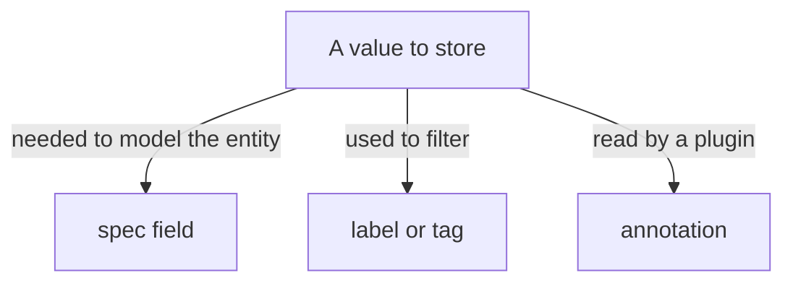

# Annotations, Labels, Tags And Spec Fields

A descriptor has several places where an author can write extra information about an entity. Choosing the wrong place causes real failures: some places reject the data, and some accept it but no consumer reads it. This part compares the four places, shows the exact rules that the catalog applies to each, and uses three failures to show how the checker reports a mistake.

## Four places for information

The entity envelope has `metadata` and `spec`. Inside `metadata` there are three places for extra data. The `spec` is the fourth.

- `metadata.labels` is a map of keys to short values. Labels identify and classify an entity, and tools use them to filter and to find related entities. Example: `tier: core`.
- `metadata.annotations` is a map of keys to strings of any length. Annotations hold non-identifying data, mostly pointers to external systems. Example: `github.com/project-slug: starfleet-org/bridge`.
- `metadata.tags` is a list of single words that classify an entity in a simple way, such as a programming language. Tags have no special meaning to the catalog.
- `spec` holds the fields that define the kind. For a Component these are `type`, `lifecycle`, `owner`, `system` and others. The catalog backend reads these fields to build relations and to validate the entity.

The test for where a value belongs is simple. If the catalog itself needs it to model the entity, it is a spec field. If a person or tool filters by it, it is a label or a tag. If a plugin reads it to reach an external object, it is an annotation.

## The rules differ by place

Labels and annotations are modelled on Kubernetes labels and annotations. Both are maps, and both keys follow the same rule: an optional lower-case domain prefix of up to 253 characters, a slash, and a required name of up to 63 characters. The name uses letters and digits separated by `-`, `_` or `.`. A key with a space is invalid.

The values differ. A label value follows the rule for a name: 1 to 63 characters, letters and digits separated by `-`, `_` or `.`. An annotation value can be any string of any length, but it must be a string. A tag uses lower-case letters, digits and the characters `:+#`, separated by `-`.



The diagram shows the decision in one step: the consumer of the value decides the place, not the format of the value.

## Try it: label values reject a locator

<!-- astrona:playground:renew -->

The value `dir:.` contains a colon, and a label value cannot contain a colon. Save this ConfigMap as `repo-bridge-label.yaml`. It puts the TechDocs key under `labels` on purpose:

```yaml
apiVersion: v1
kind: ConfigMap
metadata:
  name: repo-bridge
  namespace: catalog-source
data:
  catalog-info.yaml: |
    apiVersion: backstage.io/v1alpha1
    kind: Component
    metadata:
      name: bridge
      description: Routes requests from the shuttle to the scout
      labels:
        backstage.io/techdocs-ref: dir:.
    spec:
      type: service
      lifecycle: production
      owner: starfleet-ops
```

Apply it:

```sh
kubectl apply -f repo-bridge-label.yaml
```

Then print the errors:

```sh
inspect_catalog -c '.errors[] | {stage, message}'
```

One error appears at the `policy` stage. The message names `labels.backstage.io/techdocs-ref` and says that a label value must be a sequence of letters and digits separated by `-`, `_` or `.`, at most 63 characters, but it found `dir:.`. The entity is not ingested: the checker lists `bridge` as invalid and it is missing from `.summary.ingested`. The catalog backend rejects the whole entity for one bad value, so one wrong place can remove a component from the catalog.

## Try it: annotation values must be strings

YAML turns an unquoted `true` into a boolean. The catalog requires every annotation value to be a string. Save this ConfigMap as `repo-shuttle-boolean.yaml`:

```yaml
apiVersion: v1
kind: ConfigMap
metadata:
  name: repo-shuttle
  namespace: catalog-source
data:
  catalog-info.yaml: |
    apiVersion: backstage.io/v1alpha1
    kind: Component
    metadata:
      name: shuttle
      annotations:
        example.com/pager-enabled: true
    spec:
      type: service
      lifecycle: production
      owner: starfleet-ops
```

Apply it and print the errors:

```sh
kubectl apply -f repo-shuttle-boolean.yaml
inspect_catalog -c '.errors[] | {stage, message}'
```

The report now has a second `policy` error. It says that `/metadata/annotations/example.com~1pager-enabled` must be a string. The `~1` is how the error format writes the `/` of the key. Put quotes around the value, `"true"`, and apply the file again, and the error disappears. The same rule applies to numbers: `5` is invalid and `"5"` is valid.

## Try it: a required field is not an annotation

A common shortcut is to store a required value as an annotation because annotations accept anything. Remove `lifecycle` from `spec` and write `example.com/lifecycle: production` as an annotation instead. The key and the value are both valid, so the policy stage passes. The next stage, the kind validator, still fails:

```sh
inspect_catalog -c '.errors[] | select(.stage == "kind") | .message'
```

The message says that `/spec` must have the required property `lifecycle`. The kind validator reads only `spec`, so an annotation never satisfies a required field. Restore the real `lifecycle` field and apply the file again.

## Why the separation matters

Each consumer reads from one place. The relations processor reads `spec.owner`, `spec.system` and `spec.dependsOn`. The search and filter views read labels, tags and a few spec fields. Plugins read annotations. A value stored in the wrong place is not an error in YAML terms. It is a value that nobody reads, so the feature that needed it silently shows nothing.

Annotations are also open to extension. An organization can invent a key such as `example.com/pager-enabled` for its own tools. The fields of `spec` are defined by the kind, and the catalog and its tools read only the fields they know. A field that you invent in `spec` is read by nobody. This is the reason to use an annotation for a plugin-specific locator and not to invent a new spec field.

## What you can now do

You can place a value by asking who reads it, and you can predict how the catalog reacts to a mistake. A label value with a locator fails the policy stage. A non-string annotation value fails the policy stage. A required spec field written as an annotation fails the kind stage. The remaining question is which annotation keys the common plugins actually read, and which of them the catalog writes itself.

## Common pitfalls

> [!WARNING]
> One invalid label or annotation value removes the whole entity from the catalog. Quote annotation values that YAML would turn into booleans or numbers. Do not store required spec data, such as `lifecycle`, in an annotation, and do not put a locator that contains `:` or `/` into a label.
