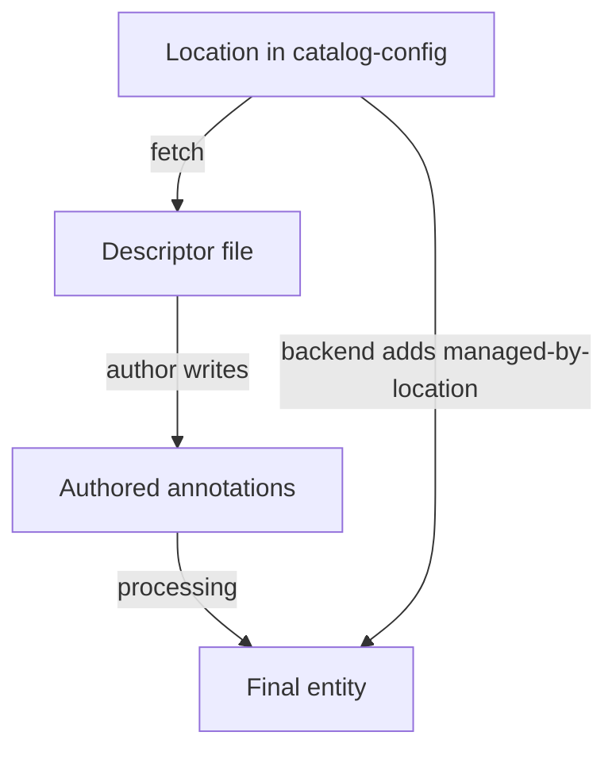

# Well-Known Annotations And Who Sets Them

Backstage documents a set of annotations that its own plugins read. Learning them saves time, because the same keys appear in almost every real catalog. This part lists the keys that matter most, shows the value format each one expects, and separates the keys that an author writes from the keys that the catalog writes. It ends with a repair of a descriptor that copied another component's identity.

## Keys that an author writes

Each key below is read by a specific plugin. The value formats come from the Backstage documentation of well-known annotations. The key `backstage.io/kubernetes-id` and the selector are read by the Kubernetes plugin; check the plugin version you install for its exact accepted values.

- `backstage.io/techdocs-ref` tells the TechDocs plugin where the documentation source is. The usual value is `dir:.`, a directory relative to the descriptor file. A value in location-reference form, such as `url:https://...`, points to a different repository.
- `backstage.io/source-location` points at the source code of the entity. It is a location reference such as `url:https://git.starfleet.example/scout/tree/main/`. For a folder, the trailing slash is required so that relative paths resolve correctly. It is useful when the descriptor is stored in a different place from the code.
- `github.com/project-slug` names a GitHub repository as `<owner>/<repository>`. It is the part of the repository address that follows the host name. A full web address is the wrong format.
- `backstage.io/kubernetes-id` is an identifier that the Kubernetes plugin matches to workloads that carry the same id as a label.
- `backstage.io/kubernetes-label-selector` is a label selector such as `app=scout`. It selects workloads directly and replaces the id-based lookup.
- `backstage.io/view-url` and `backstage.io/edit-url` change the links that the entity page shows. The view URL should point to the canonical descriptor and the edit URL to the file that people edit. They matter when the descriptor is generated from another file.

The annotation keys are case sensitive in practice, because a plugin looks up an exact string. A key written as `Github.com/project-slug` or `github.com/project_slug` is a different key and nobody reads it.

## Keys that the catalog writes

Some keys are not for authors. The catalog backend adds them while it ingests an entity. The key `backstage.io/managed-by-location` records the location the entity was read from, as a location reference such as `url:https://git.starfleet.example/bridge/blob/main/catalog-info.yaml`. The key `backstage.io/managed-by-origin-location` records the location whose registration created the entity. These two are how the catalog knows which entities to update or remove when a location changes.

An author does not set them. The catalog adds its own value during processing, so a hand-written value is at best ignored and at worst misleading to the person who reads the file. Never copy these two keys from an entity that you inspected in the interface into a descriptor.

## Try it: see what the catalog added

<!-- astrona:playground:renew -->

The descriptor of `bridge` in the playground contains six annotations that the author wrote. Print the annotations that the catalog holds for it:

```sh
inspect_catalog -c '.entities[] | select(.ref == "component:default/bridge") | .metadata.annotations'
```

The map has seven keys. Six come from the file. The seventh, `backstage.io/managed-by-location`, does not appear in the descriptor. The checker added it with the address of the file that it read, `url:https://git.starfleet.example/bridge/blob/main/catalog-info.yaml`. The Backstage backend does the same during processing.



The diagram shows that the entity holds the authored annotations plus a value derived from the location that fetched the file.

## Try it: add three annotations to scout

The `scout` Component lacks documentation and source links. Save this ConfigMap as `repo-scout-docs.yaml`. It keeps the corrected identity values and adds the three keys:

```yaml
apiVersion: v1
kind: ConfigMap
metadata:
  name: repo-scout
  namespace: catalog-source
data:
  catalog-info.yaml: |
    apiVersion: backstage.io/v1alpha1
    kind: Component
    metadata:
      name: scout
      description: Website that shows scan results
      annotations:
        github.com/project-slug: starfleet-org/scout
        backstage.io/kubernetes-id: scout
        backstage.io/techdocs-ref: dir:.
        backstage.io/source-location: url:https://git.starfleet.example/scout/tree/main/
        backstage.io/kubernetes-label-selector: app=scout
    spec:
      type: website
      lifecycle: experimental
      owner: scout-team
```

Apply it:

```sh
kubectl apply -f repo-scout-docs.yaml
```

Then check the result:

```sh
inspect_catalog -c '.entities[] | select(.ref == "component:default/scout") | {ingested, annotations: .metadata.annotations}'
```

`ingested` is `true` and the map has the five authored keys plus `managed-by-location`. The checker accepts any string for these keys. It does not test that `dir:.` points at real documentation or that the selector matches pods. A plugin makes those tests when a user opens the page.

## When two keys overlap

The Kubernetes plugin can find workloads by id or by selector. If both annotations are present, an author must know which one the plugin installed in the application prefers. When they disagree, the page shows the result of one of them and the other is ignored without a message. The safest habit is to write only the key that the team uses, and to keep its value equal to the workload labels.

The same care applies to a value that you copy from a template. A template that fills `github.com/project-slug` from the repository name keeps the value correct for every new component. A hand-copied descriptor keeps the value of the source component, which is how the playground `scout` got the `bridge` slug.

## How to review an annotation

A short review has three steps. First, confirm that the key is a known contract and is spelled exactly. Second, confirm that the value has the format of that contract: `<owner>/<repository>` for a slug, a location reference for a source location, a selector for a selector. Third, confirm that the value names this entity's object and not another one. The checker can help with the first step through the errors list and with the third through a direct comparison of annotations. It cannot do the second step for plugin-specific formats.

## What you can now do

You know the common keys, their value formats, and which two keys the catalog adds itself. You can review a descriptor for the three failures that matter: an unknown or misspelled key, a value with the wrong format, and a value that names another component. The next step is to apply these checks on a real estate that has several mistakes at once.

## Common pitfalls

> [!WARNING]
> Do not write `backstage.io/managed-by-location` or `backstage.io/managed-by-origin-location` in a descriptor; the catalog adds them. A key that differs by one character is a different key and nothing reads it. Check the value format of every key, and remember that a folder in a location reference needs a trailing slash.
