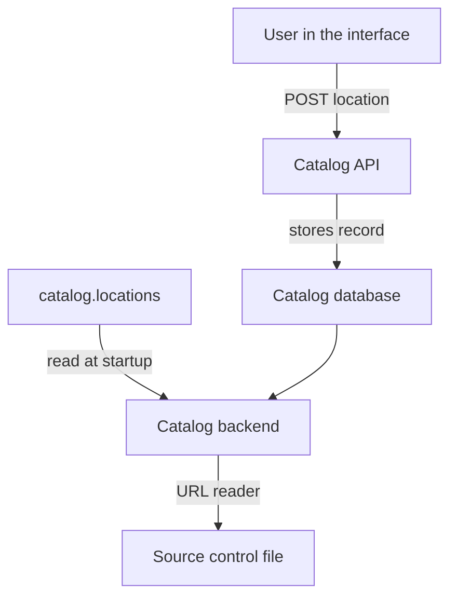

# Registering Locations And Source Access

The catalog does not search the internet for software. It only knows what somebody tells it. The first thing that somebody tells it is a location: the address of a file that holds one or more entity descriptors. This chapter shows what a location is, the two ways to register one by hand, how the catalog reads the file behind it, and why a successful registration does not yet mean that an entity exists.

## What a location is

A location is a pair of two strings: a type and a target. The type says which reader fetches the file. The target says where the file is. For a descriptor in a source control system, the type is `url` and the target is the web address of the file, for example `https://github.com/starfleet/bridge/blob/main/catalog-info.yaml`.

The catalog backend owns the work from there. It stores the location, and a component called the URL reader fetches the file with the credentials from the backend integration configuration. The backend then parses the file, validates every document and publishes the entities. The person who registered the location does none of this work, and the browser plays no part in it.

This matters for the first rule of this topic: the backend reads the file, so the backend needs access to it. Your own access to a private repository proves nothing about the access of the backend integration.

## Two ways to register a location

There are two ways to register a location by hand. They end in the same place, but they differ in where the registration is stored and who can remove it.

The first way is the static configuration. The application configuration has a `catalog` key with a `locations` list. Each item is a location:

```yaml
catalog:
  locations:
    - type: url
      target: https://git.starfleet.example/bridge/blob/main/catalog-info.yaml
```

The configuration is a file that belongs to the deployment. It is reviewed, versioned and deployed like code. The backend reads it when it loads its configuration, so a change normally reaches the running catalog with a new deployment or a restart.

The second way is the registration interface. In the Backstage web interface, a user opens the page to register an existing component, pastes the target and confirms. The page calls the catalog API, which creates a location record in the catalog database. Sending a `POST` request with the type and the target to the locations endpoint of the catalog API does the same without the interface. The registration is stored in the database, not in a file, so nobody reviews it and it is not part of a deployment.

The two ways differ in removal. A location from the static configuration cannot be removed through the catalog API; the only way is to delete it from the configuration. A location created through the interface or the API can be removed through the interface or the API, as long as the catalog is not set to read only. The option `catalog.readonly: true` disables registering and deleting locations through the API, and teams use it to make the configuration the only source.

The playground and the labs here can use only the static configuration, because they do not run the Backstage application. The interface and the API are explained so that you can answer questions about them, but you cannot call them in this environment.



The diagram shows two inputs, the configuration and the database, that both end at the catalog backend, and one reader that fetches the file.

## The model in this playground

The playground keeps the source in ConfigMaps so that you can change it with `kubectl`. A ConfigMap named `repo-<name>` is one repository, and each key of its data is a file. A checker pod reads all ConfigMaps and prints a report. It models the target address like this: `https://git.starfleet.example/<repo>/blob/<branch>/<file>` points at the key `<file>` of the ConfigMap `repo-<repo>`, and the branch must equal the annotation `astrona.io/default-branch` of that ConfigMap. Without the annotation, the branch is `main`.

<!-- astrona:playground:renew -->

Define the helper that sends the ConfigMaps to the checker:

```sh
inspect_catalog() {
  kubectl -n catalog-source get configmap -o json | kubectl -n catalog-tools exec -i deploy/catalog-tools -- node /opt/check/inspect.js | jq "$@"
}
```

Print the registered locations as the checker read them:

```sh
inspect_catalog -c '.locations[] | {target, origin, status}'
```

The first four lines are the four items of `catalog.locations`, and their `origin` is `config`. The status of each is `ok`, which means the checker found the file. The last two lines have an `origin` that is the address of another file. Those two were not registered by hand. A `Location` entity in another file listed them.

## Fetching is the first thing that can fail

A location that cannot be read produces a fetch error. The catalog keeps the registration and reports the error, and it publishes nothing from that location. In the real catalog the reason can be a wrong address, a wrong branch, a file that moved, or credentials that the integration does not have.

The repository `scout` exists in the playground, but no location points at it. Its ConfigMap has the annotation `astrona.io/default-branch: trunk`. Save this as `catalog-config.yaml`. It replaces the catalog configuration with the same four locations plus one for `scout` that uses the branch `main`:

```yaml
apiVersion: v1
kind: ConfigMap
metadata:
  name: catalog-config
  namespace: catalog-source
data:
  app-config.yaml: |
    catalog:
      locations:
        - type: url
          target: https://git.starfleet.example/starfleet-org/blob/main/org.yaml
          rules:
            - allow: [Group, User]
        - type: url
          target: https://git.starfleet.example/fleet-registry/blob/main/catalog-info.yaml
        - type: url
          target: https://git.starfleet.example/bridge/blob/main/catalog-info.yaml
        - type: url
          target: https://git.starfleet.example/legacy-probe/blob/main/catalog-info.yaml
        - type: url
          target: https://git.starfleet.example/scout/blob/main/catalog-info.yaml
```

Apply it:

```sh
kubectl apply -f catalog-config.yaml
```

Then read the errors:

```sh
inspect_catalog -c '.errors[]'
```

One error appears. Its `stage` is `fetch` and its message is `NotFoundError: the file does not exist at this location`. The registration is accepted, the location is in the list, and no `scout` entity exists. Change `main` to `trunk` in the file, apply it again and read the errors again. The error is gone, and `component:default/scout` appears in `.summary.ingested`.

## Accepted is not published

The result teaches the main point of this chapter. Registration only records an input. The catalog checks very little at that moment. The later stages decide whether an entity appears: the fetch, the YAML parsing, the validation of each document, the rules that allow a kind and the resolution of relations.

The real catalog also works in the background. After registration, the entities appear after the backend processes the location, and the backend repeats the work on a schedule. A short delay is normal. A location that stays empty for a long time needs evidence from the processing status, not another registration.

A fetch error also leaves clues in its text. A "not found" message points at the address, the branch or the file name. An "unauthorized" or "forbidden" message points at the credentials of the backend integration. Reading which of the two you have saves a lot of time, because the repairs are in different places.

In the real system, the integration identity is the one that matters. An integration for a source control host holds a token or an application credential in the backend configuration. If a team makes a repository private after registration, the backend loses access and fetch errors start, while every person on the team can still open the file. Never paste that token into a descriptor, a ticket or a chat to "test" it.

You now know how a registration becomes a fetch and where a fetch fails. Two questions remain open: what happens when the file behind a location lists more locations, and how the catalog decides which kinds a file may contain.

## Common pitfalls

> [!WARNING]
> A registered location is not a published entity. Check the stage of the error before you register the same address again. A wrong branch, a wrong file name and a missing credential are different faults with different repairs. Your own access to a repository is not the access of the backend integration, and a location in the static configuration cannot be removed through the catalog API.
