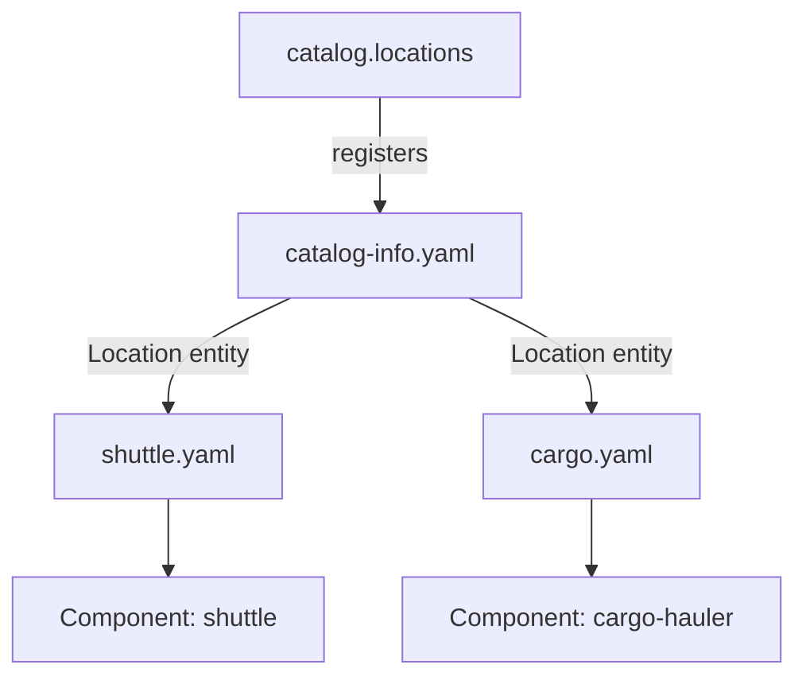

# Location Entities, Rules And Removing A Registration

One registered location can lead to many files. A file can hold an entity of the kind `Location`, and that entity lists further targets. This lets a team register one root address and describe a whole tree of descriptors. The same design raises two questions: which kinds of entity is a file allowed to contain, and what does it mean to take a registration away. This chapter answers both with the playground.

## The Location entity

A `Location` is an entity kind, like `Component` or `Group`. Its descriptor has the usual envelope with `apiVersion`, `kind`, `metadata` and `spec`. The `spec` can have these fields:

- `type`: the location type that is common to all targets. When it is missing, the entity inherits the type of the location that read it. In practice this is `url`.
- `target`: one target as a string.
- `targets`: a list of targets as strings.
- `presence`: whether the target must exist. The default is `required`. The value `optional` tells the catalog that a missing target is acceptable.

A target is either an absolute address or a relative path. A relative path resolves against the address of the file that holds the `Location` entity. In the playground, the file `catalog-info.yaml` of `fleet-registry` holds this entity:

```yaml
apiVersion: backstage.io/v1alpha1
kind: Location
metadata:
  name: fleet-registry
  description: Lists the descriptor files of the fleet team
spec:
  targets:
    - ./shuttle.yaml
    - ./cargo.yaml
```

The path `./shuttle.yaml` resolves to the file `shuttle.yaml` in the same directory, which is the same repository and branch. This is why a team can move a whole tree to another branch by changing only the root registration, as long as it uses relative targets.

The catalog backend does the work in this order. It reads the registered file, validates the `Location` entity and publishes it like any other entity. A processor for the kind `Location` then reads the targets and starts a read of each one. Each new file goes through the same stages, and it can contain another `Location` entity.

<!-- astrona:playground:renew -->

Read the locations again. Registered locations have the origin `config`. The others show the address of the file that listed them:

```sh
inspect_catalog -c '.locations[] | {target, origin, status}'
```

Two lines have the address of `fleet-registry/blob/main/catalog-info.yaml` as their `origin`. Their targets are `shuttle.yaml` and `cargo.yaml` in the same repository. Nobody registered those two files. The entity of kind `Location` caused the reads.

Now look at what the catalog stores about a component that came this way:

```sh
inspect_catalog -c '.entities[] | select(.ref == "component:default/cargo-hauler") | .metadata.annotations'
```

The result has one annotation, `backstage.io/managed-by-location`, with the value `url:https://git.starfleet.example/fleet-registry/blob/main/cargo.yaml`. The catalog adds this annotation. The author of the descriptor never writes it. It records which location produced the entity, and the catalog uses it to find the entity again when that location changes or goes away.



The diagram shows one registered address that leads to two more files, and each file produces one entity.

## A target that does not exist

A mistyped target fails like any other fetch. Change the second target in the `Location` entity from `./cargo.yaml` to `./cargo.yml`. Save the file text of the ConfigMap key:

```sh
kubectl -n catalog-source get configmap repo-fleet-registry -o jsonpath='{.data.catalog-info\.yaml}' > catalog-info.yaml
```

Edit `catalog-info.yaml` so the target reads `./cargo.yml`, write the text back with a merge patch and read the errors:

```sh
kubectl -n catalog-source patch configmap repo-fleet-registry --type merge -p "$(jq -n --rawfile text catalog-info.yaml '{data: {"catalog-info.yaml": $text}}')"
inspect_catalog -c '.errors[]'
```

The report shows one error in the stage `fetch` for the address that ends in `cargo.yml`, with the message `NotFoundError: the file does not exist at this location`. The `Location` entity itself and `shuttle` stay ingested. Only the one target fails. Change the text back to `./cargo.yaml` and write it again before you continue.

## Rules decide which kinds a file may contain

A file can pass validation and still be refused. The catalog has a list of rules that name the kinds of entity that may enter the catalog. When no `catalog.rules` key exists, the default rules allow `Component`, `System`, `API`, `Resource` and `Location`. A `Group`, a `User` or a `Domain` is refused. Organization data is usually added on purpose.

There are two places to add a rule:

- The global list, `catalog.rules`. When it is present, it replaces the default list. A list that names only `Group` removes `Component` from the allowed kinds.
- The `rules` key of a statically configured location. It adds allowed kinds for the file at that location only.

The playground registers `org.yaml` with a rule of its own:

```yaml
- type: url
  target: https://git.starfleet.example/starfleet-org/blob/main/org.yaml
  rules:
    - allow: [Group, User]
```

Remove the `rules` lines from that item in the catalog configuration and apply it. Read the first error:

```sh
inspect_catalog -c '.errors[0]'
```

The error has the stage `rules`. Its message is `rules: entity of kind Group is not allowed from location url:https://git.starfleet.example/starfleet-org/blob/main/org.yaml`. The file is valid and was read. The rules refused each group and the user, so they are not ingested. Put the `rules` lines back and apply the file again.

The scope of the per-location rule has a limit that matters for trees. A rule on a registered location applies to entities read from that file. It does not apply to files that a `Location` entity lists. Those entities are checked against the global rules only. If `org.yaml` were a target of a `Location` entity, the per-location rule on its own registration would not help, and the groups would need an entry in the global `catalog.rules`, which must then name every other kind that must stay allowed.

## Removing a registration

A registration is only an input. Removing it stops the catalog from reading that file. It does not delete the file, the repository or the software.

The playground still registers `legacy-probe`, a service that was retired. Delete the item with the address of `legacy-probe` from the `locations` list in the catalog configuration, and apply the file. Then ask whether the component is still in the report and whether the repository still exists:

```sh
inspect_catalog -c '[.entities[] | select(.name == "probe")] | length'
inspect_catalog -c '.repos'
```

The first command prints `0`, and the second still lists `legacy-probe`. The source stays. Only the registration went away.

The checker removes the entities at once because it only models the inputs. The real catalog takes more steps before an entity disappears. One fact is certain for a static location: it can leave the catalog only through the configuration, because the catalog API refuses to delete it.

For a location from the interface, the choice is different. A user can unregister the root through the interface. When a location is a root, the catalog removes every entity below it in one operation. The interface warns about this before it deletes.

## Summary of the mechanism

A `Location` entity turns one registration into a tree. Relative targets resolve against the file that holds the entity, and each target is fetched like any other file. Rules filter by kind, and the global rules are the only rules that apply to a file reached through a `Location` entity. Removing a registration removes the input, not the source.

The open question is what happens to entities that the catalog already published when their source changes or disappears.

## Common pitfalls

> [!WARNING]
> A `catalog.rules` key replaces the default list, so a list with only `Group` blocks every `Component`. A rule on one registered location does not cover files that a `Location` entity lists. A relative target resolves from the file of the `Location` entity, not from the root of the repository. Removing a registration does not delete the source repository.
