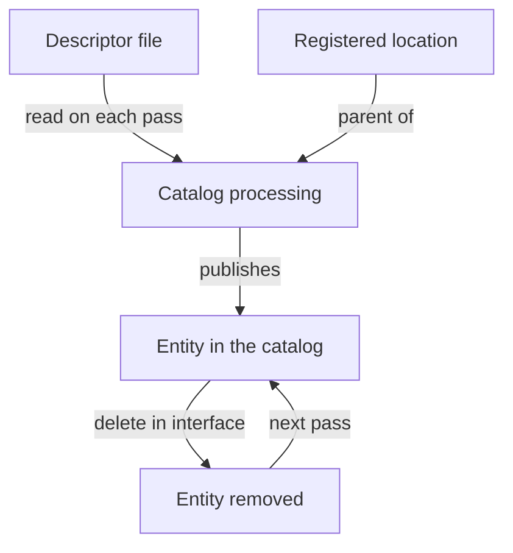

# Entity Lifecycle: Orphans, Rediscovery And Conflicts

A registered location does not only create entities. It also keeps them alive, changes them and, at the end, decides whether they are removed. Many surprises with manual registration come from this lifecycle: an entity that returns after somebody deleted it, an entity that stays after its repository is gone, or two files that fight for one name. This chapter explains the rules behind those cases and the one habit that avoids them: change the source, not the published entity.

## Where an entity gets its life

Every published entity has a parent that maintains it. The parent is the location, or the `Location` entity, that produced it. The catalog records this with the annotation `backstage.io/managed-by-location`. The backend processes each entity again and again, on a schedule that the configuration key `catalog.processingInterval` suggests. The documentation calls the value only a suggested minimum, so the real interval can be longer. Each pass reads the source file again, so a change in the file reaches the catalog without any new registration.

The consequence is that the source file is the truth. The published record is a copy that the catalog refreshes from the source. If the copy and the source disagree, the next processing pass makes the copy equal to the source again.



The diagram shows that deleting the published entity removes the copy only, and the next processing pass publishes it again from the file.

## Deleting the entity does not retire the software

The catalog API and the interface can delete a single entity. When a parent still maintains that entity, the deletion does not last. The catalog documentation says so directly: the entity would reappear shortly afterwards. The registered location is still there, the file is still there, and the next pass creates the entity again.

To retire software, change the source. There are three ways, and each fits a different situation:

- Remove the entity document from the descriptor file. The location stays registered. The file no longer produces the entity.
- Remove the target from the `Location` entity that lists the file. The location entity no longer reads that file.
- Remove the registration. For a static location this means a change in the configuration. For a location created through the interface, it means unregistering the root.

Pick the smallest change that matches what you want to retire. One component in a file with many components is retired by editing the file. A whole repository is retired by removing its registration.

## Orphans

An entity is an orphan when nothing maintains it any more. This happens when the parent that produced it is gone: the registration was removed, or the `Location` entity stopped listing the file. The catalog marks the entity with the annotation `backstage.io/orphan` set to `'true'`, and the interface can show a warning.

What happens next depends on one configuration key. By default, the catalog removes orphaned entities automatically. With `catalog.orphanStrategy: keep`, the catalog keeps them until somebody deletes them with the catalog API. A team picks `keep` when it prefers to review removals by hand, and it then carries the cost of cleaning up.

Two facts prevent wrong conclusions:

- Removing a file, or breaking a file so that it cannot be read, does not orphan its entities. The entity still has its parent, and the catalog marks a read error on the entity. A missing file is an error to fix, not a retirement.
- An orphan marker is a statement about the catalog, not about the software. The service may still run. Deleting the entity of a running service hides it from the people who need to find it.

The checker in the playground does not model orphans, because it has no stored state between runs. It shows only the inputs: what a location produces today. Use it to read the effect of a source change, and read the rules above for what the real catalog does with the old record.

## Rediscovery and duplicate claims

A source can produce the same entity from two places. Two files can declare a `Component` named `bridge` in the namespace `default`. Both documents describe the entity `component:default/bridge`, and an entity reference is unique in the catalog, so only one location can maintain it.

<!-- astrona:playground:renew -->

Make the conflict yourself. Save the text of the file `shuttle.yaml` of the repository `fleet-registry`:

```sh
kubectl -n catalog-source get configmap repo-fleet-registry -o jsonpath='{.data.shuttle\.yaml}' > shuttle.yaml
```

Open `shuttle.yaml` and add a second document at the end, after a line with three dashes. Give it the kind `Component`, the name `bridge`, the type `service`, the lifecycle `production` and the owner `fleet-team`. Write the text back with a merge patch and read the conflicts:

```sh
kubectl -n catalog-source patch configmap repo-fleet-registry --type merge -p "$(jq -n --rawfile text shuttle.yaml '{data: {"shuttle.yaml": $text}}')"
inspect_catalog -c '.conflicts'
```

The report lists the reference `component:default/bridge` with two locations: the file `catalog-info.yaml` of the repository `bridge` and the file `shuttle.yaml` of `fleet-registry`. Now see which one the catalog kept:

```sh
inspect_catalog -c '.entities[] | select(.ref == "component:default/bridge") | {location, ingested}'
```

Two lines appear. The one from the repository `bridge` has `ingested` set to `true`. The one from `shuttle.yaml` has `ingested` set to `false`. The checker keeps the claim that it read first. The registration order decided, and nothing about the content did. The real catalog also keeps one claim and reports a conflict on the other, but you must not rely on which one wins. Remove the extra document so that each entity has one source, and then write the file back.

Conflicts also happen when two kinds of input meet. A static location and an automated provider can both reach one repository file. A manual registration can duplicate what a discovery provider already finds. Choose one owner of each source. When the two overlap, retire one of them.

## A lifecycle habit

A short routine keeps the registrations healthy:

- Write down which location produces each entity. The annotation `backstage.io/managed-by-location` has the answer.
- Retire software in the descriptor or in the registration. Do not use the delete button on a published entity that still has a parent.
- Read the state of each location after a change: status, error stage and conflicts.
- Never decide on deletion from an orphan marker alone. Check the software first.

Read only catalog setups can change the workflow. With `catalog.readonly: true`, the interface has no registration button and the API refuses to create or delete locations. This is a policy, not a defect of the interface.

You now know why a published entity follows its source, why deletion in the interface does not stick, how orphans appear and how duplicate claims show up as conflicts. The remaining skill is to combine these in a whole estate, with a root location, rules and a retirement.

## Common pitfalls

> [!WARNING]
> Deleting a published entity that still has a registered parent only hides it until the next processing pass. A missing or unreadable file does not orphan its entities. An orphan marker does not prove the software stopped running. Two files that declare the same entity reference conflict, and the order of reading decides the winner, not the quality of either file.
