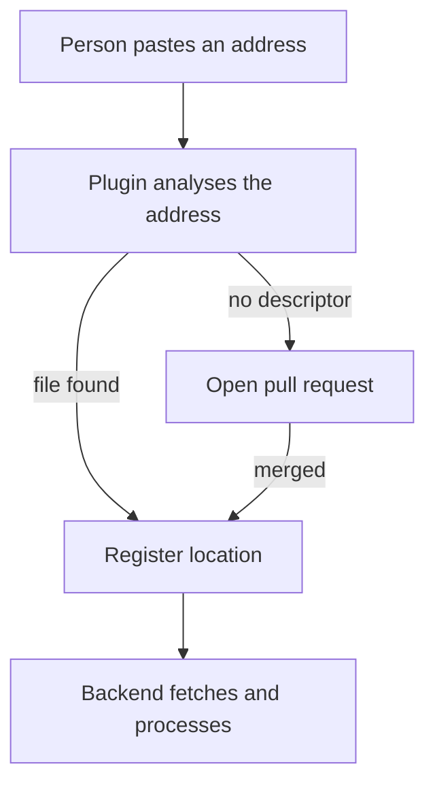

# The Import Flow And File Names

Most people register a location through the catalog interface, not through the configuration. The interface hides the steps, so a failed import can look like a mystery. This part describes what the import flow does, which file names and addresses it expects and how the same rules apply to a location that you write by hand.

## What the import page does

The catalog import plugin adds a page where a person pastes an address. The page has two paths. If the address points at a file, the plugin asks the catalog to analyse it and shows the entities that the file would produce. The person confirms, and the plugin registers a location of the type `url` with that address. The catalog then fetches and processes the file as it does for any location.

If the address points at a repository and the repository has no descriptor, the plugin can offer a pull request instead. It uses the source control integration of the backend to open a pull request that adds a descriptor file with a generated `Component`. The default file name is `catalog-info.yaml`, and the configuration key `catalog.import.entityFilename` changes it. The default branch name of the pull request is `backstage-integration`, and the key `catalog.import.pullRequestBranchName` changes it. The pull request needs a write permission that the integration credentials must have.



The diagram shows that registration is a separate step after the analysis, and that the pull request path ends in the same registration.

## Addresses and file names

A location has the type `url` and a target. The target is the full address of one file, such as `https://git.starfleet.example/scout/blob/trunk/service.yaml`. The file name is free. The name `catalog-info.yaml` is only the default of the import plugin and of the GitHub discovery provider. A location can point at `service.yaml`, `component.yaml` or any other file, as long as the reader can fetch it.

The branch is part of the address. If the address names a branch that does not exist, the fetch fails with a not found error, as the earlier parts showed. A mistake in the file name gives the same error, so check both parts of the address when a fetch fails.

<!-- astrona:playground:renew -->

The repository `scout` has a descriptor file that no location registers, and its default branch is `trunk`. Paste the helper function once:

```sh
inspect_catalog() {
  kubectl -n catalog-source get configmap -o json | kubectl -n catalog-tools exec -i deploy/catalog-tools -- node /opt/check/inspect.js | jq "$@"
}
```

Save a second descriptor with a free file name as `service.yaml`:

```yaml
apiVersion: backstage.io/v1alpha1
kind: Component
metadata:
  name: scout-extra
  description: Second component in the scout repository
spec:
  type: service
  lifecycle: experimental
  owner: fleet-team
```

Add it to the repository as a second file. The ConfigMap key becomes the file name:

```sh
kubectl -n catalog-source patch configmap repo-scout --type merge -p "$(jq -n --rawfile text service.yaml '{data: {"service.yaml": $text}}')"
```

Save the catalog configuration, add a location for the new file and apply it. Add this item to the `locations` list in the `app-config.yaml` text of `catalog-config.yaml`:

```yaml
- type: url
  target: https://git.starfleet.example/scout/blob/main/service.yaml
```

The branch `main` is wrong on purpose, because the repository uses `trunk`. Save and apply the configuration:

```sh
kubectl -n catalog-source get configmap catalog-config -o yaml > catalog-config.yaml
kubectl apply -f catalog-config.yaml
```

Read the status of the location and the error:

```sh
inspect_catalog -c '.locations[] | select(.target | endswith("service.yaml")) | {target, status}'
inspect_catalog -c '.errors[] | select(.location | endswith("service.yaml"))'
```

The status is `not-found`, and the error is at the stage `fetch`. The file exists, so the branch is the cause. Change `main` to `trunk` in that location, apply the file again and read `.summary.ingested`. The entity `component:default/scout-extra` is now in the list, and the file name was never a problem.

## What you now know

You know what the import page does, why it separates analysis from registration and why a pull request path exists. You know that the file name is free and that the branch and the file name are both parts of the address. The open question is what happens to the registration later, when the file moves or the repository is retired.

## Common pitfalls

> [!WARNING]
> The import page registers the location. It does not guarantee that the entities are valid or allowed, so read the status after the import. Opening a pull request needs write access for the backend integration. A different default branch gives a not found error even when the file exists.
