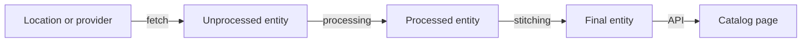

# Fetching, Processing, Stitching And Publication Evidence

When an entity is missing from the catalog, the first question is not "what is wrong" but "where did it stop". The catalog backend turns a file in a source repository into a published entity in several steps, and each step can fail for its own reason and leaves its own evidence. A reader who knows the steps can find the broken one in a few minutes. A reader who does not will try fixes at random.

This part names the steps, says which component does the work in each, and shows where the evidence of each failure appears.

## The steps from a file to an entity

The catalog backend is the server part of the Backstage catalog. It does not read your repositories when a user opens a page. It works in the background and keeps a stored, processed copy of every entity. The page then reads the stored copy.

Four steps lead to that copy:

1. Ingestion. An entity provider or a registered location tells the backend which sources to read. The backend fetches the file through an integration (for a Git host, a reader with credentials) and stores each entity of the file in its unprocessed form.
2. Processing. Processors take each unprocessed entity one at a time. They check the entity against the entity policies and the schema of its kind, check the catalog rules, and emit relations and, for a `Location` entity, more locations to read.
3. Stitching. The stitcher merges the processed entity with the relations that every other entity emitted about it. The merged result is the final entity.
4. Publication. The final entity is the one the API and the interface return. An entity is not visible to users before it passes the last step.



The diagram shows the order of the steps: an entity reaches the catalog page only after it has passed fetch, processing and stitching.

## Where a failure leaves evidence

Each step reports in a different place. This is why one generic answer such as "the catalog is broken" never helps.

A fetch failure happens before the file is read. The location has no entities, and the error says that the file was not found or that no reader can read the location. Nothing about the entity is known, because the backend never saw it.

A parse failure happens when the file is read but is not valid YAML (YAML Ain't Markup Language, the text format of descriptor files). The backend cannot tell which entity the text should have been. The error names a line and a column of the file.

A validation failure happens when the YAML is valid but the entity breaks a rule. The entity policies check the envelope: `apiVersion`, `kind`, `metadata` and the format of names, labels and annotations. The schema of the kind checks `spec`. The catalog rules decide whether the kind is allowed from the location. The backend records the error against the entity.

A relation problem happens after validation. The entity is valid, but a field such as `spec.owner` or `spec.dependsOn` names a target that does not exist, or a reference has no kind where one is required.

An identity conflict happens when two locations declare the same reference, which is the combination of kind, namespace and name. The catalog keeps one entity per reference.

The Backstage documentation says that an entity with a processing error does not replace the last error-free version among the final entities. A broken change can therefore leave the old version visible, which is why a page can look fine while the new descriptor is rejected.

## The inspector report in the playground

The playground does not run the Backstage backend. A pod in the `catalog-tools` namespace runs an inspector that reads the descriptor ConfigMaps and prints one JSON report. It uses the real `@backstage/catalog-model` library for validation and models locations, rules, relations and conflicts. Its fields follow the steps above: `.locations` for fetch, `.errors` with a `stage`, `.conflicts`, `.unresolved` and `.summary`.

The guide of the playground defines a shell function `inspect_catalog` that sends the ConfigMaps to the pod and passes your arguments to `jq`. Define it first. Then renew the playground, which resets its timer.

<!-- astrona:playground:renew -->

Print the summary of the report:

```sh
inspect_catalog -c '.summary'
```

The summary has the list `ingested` with the reference of every published entity and the number `errorCount`. In the starting estate the list holds the two groups, `bridge`, `scout` and `telemetry-db`, and the count is greater than zero. The entity `probe` is missing from the list.

Now print the errors:

```sh
inspect_catalog -c '.errors[]'
```

Each error has a `location`, a `stage` and a `message`. The error of `probe` has the stage `kind`. The message names the property that the Component schema requires and the descriptor does not have. This one error already answers "where did it stop": the file was fetched, it parsed, and it failed the schema of its kind.

Compare that with the report item of the entity:

```sh
inspect_catalog -c '.entities[] | select(.location | contains("/probe/")) | {kind, valid, ingested, errors}'
```

The item shows `valid` as false, `ingested` as false and the same error text. The fetch step and the parse step succeeded, so the entity exists in the report; only the validation step failed.

## Reading a failure from the outside

Use the order of the steps as a checklist. Ask first whether the location was read: if its status is not `ok`, the entity never reached processing, and editing the descriptor cannot help. Ask next whether the file parsed. Ask then whether the entity is valid and allowed. Ask last whether its relations resolve and whether another location claims the same reference.

This order also stops a common mistake. A failed entity is a statement about the metadata pipeline. It is not a statement about the software that the entity describes. The `probe` service can run without errors in production while its descriptor fails the schema.

The durable repair always belongs to the source of truth: the descriptor file or the catalog configuration. The published entity is a result that the next ingestion cycle replaces. An edit to the result, even if a tool allowed it, would not last. Retrying only helps for a temporary failure such as a source that was down for a short time; a malformed file fails the same way on every retry.

You now know the steps and the evidence each one leaves. The question that remains is how a fetch failure and a parse failure look in detail, and how to tell the two apart from the location status alone.

## Common pitfalls

> [!WARNING]
> Do not read a missing entity as a service outage or as a catalog outage. The backend can be healthy while one location is not found, one file does not parse or one entity fails validation. Find the step that stopped first, and repair the source file or the catalog configuration, not the published result.
