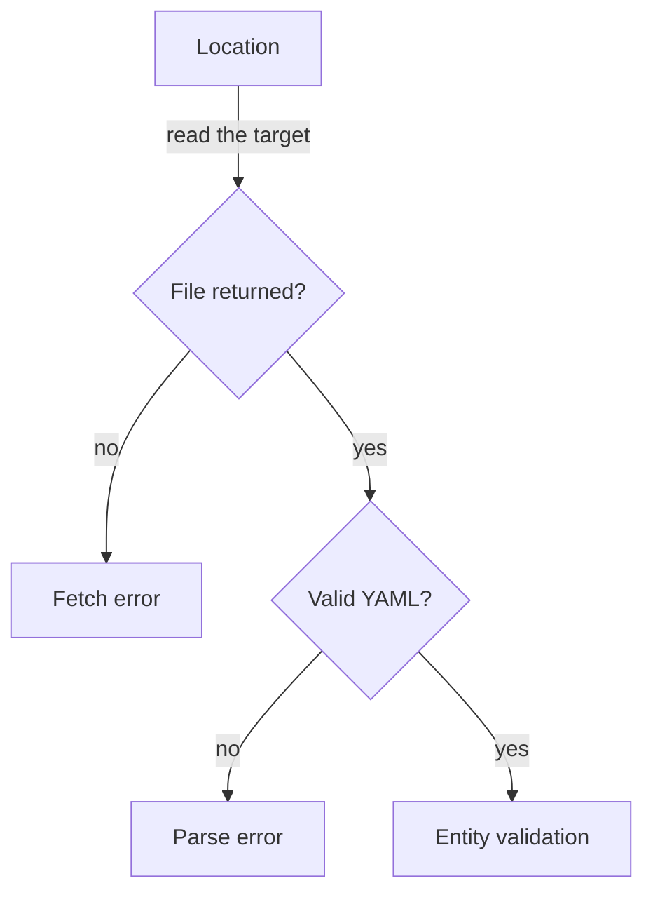

# Fetch And Parse Failures

Two kinds of failure stop an entity before the catalog ever looks at its content. In the first, the backend cannot read the file at the location. In the second, it reads the file but cannot parse the text as YAML. Both end with a missing entity and an error, and the two are easy to confuse. The repair is different for each: a fetch failure is repaired in the location, a parse failure in the file.

## What a location is

A location is a pointer. It has a type and a target. The common type is `url`, and the target is the address of one descriptor file, for example `https://git.starfleet.example/scout/blob/main/catalog-info.yaml`. In the playground, that address maps to the key `catalog-info.yaml` of the ConfigMap `repo-scout`, on the branch `main`.

Locations come from three places. The static configuration lists them under `catalog.locations`. A user or a tool can register one through the interface or the API. A `Location` entity can name more targets in `spec.target` or `spec.targets`. A target that starts with `./` is relative to the file that holds the `Location` entity.

The backend does not check the pointer when you write it. It follows the pointer at fetch time, in the background. The configuration can therefore be accepted without a problem and fail an hour later.

## Fetch failures

The step that follows the pointer is the fetch. The component that does the work is the reader of the integration for that host. If the reader gets no file, or no reader exists for the location type, the fetch fails and the location yields no entities at all.

Four causes are common:

- The branch in the URL is not the branch that holds the file. The URL `blob/master/catalog-info.yaml` fails when the default branch is `main`.
- The file name or path is wrong, for example `catalog.yaml` instead of `catalog-info.yaml`.
- The repository is private and the integration has no credentials for it, or the credentials expired. The backend then gets a denial from the host. The credentials belong to the backend, not to the user who looks at the page.
- The location has a type that the backend cannot read. In the playground model, any type other than `url` is reported with the status `unsupported-target`.

The evidence has two parts. The location item in the report carries a status that is not `ok`. The error list has an entry with the stage `fetch`. There is no entity in the report for that location, because no file was read.



The diagram shows that the location status and the parse result decide whether the entity reaches validation at all.

## Parse failures

If the file arrives, the backend splits it into documents (a `---` line separates them) and parses each one. A document that is not valid YAML produces a parse error. The other documents of the same file can still be fine, so one broken document does not have to hide the rest.

The most common cause is a colon followed by a space inside a value that is not in quotes. YAML reads `description: Reaches the probe: always` as a mapping inside a mapping value, and a plain value on one line cannot hold that. The same happens with a value that starts with `@` or `*`, a tab used as indentation, or a list item with the wrong indentation.

The message names a line and a column. Real parse errors in descriptors come from the YAML parser, so the exact text depends on the parser. The line and column are the useful part. Open the file, go to that line, and look at the characters before the column.

A parse error does not say which entity the text was meant to be. The backend has no reference for it, because the `kind` and the `name` come from the parsed text. That is why the error carries a location and no entity reference.

## Telling the two apart

The location status separates them. A location with a status that is not `ok` is a fetch failure, and the descriptor file is not the problem. A location with the status `ok` and an error of the stage `parse` is a parse failure, and the location is not the problem.

This matters for the repair. Editing the descriptor cannot fix a wrong branch in the location, and changing the location cannot fix a colon in a description. A learner who sees only "the entity is missing" tends to change both, and often breaks something that worked.

## Try it: break a location and a file

Renew the playground first, so its timer is reset.

<!-- astrona:playground:renew -->

Save the full configuration with the `scout` location pointed at the wrong branch. Save this as `catalog-config.yaml`:

```yaml
apiVersion: v1
kind: ConfigMap
metadata:
  name: catalog-config
  namespace: catalog-source
data:
  app-config.yaml: |
    catalog:
      rules:
        - allow: [Component, System, API, Resource, Group, User, Location]
      locations:
        - type: url
          target: https://git.starfleet.example/starfleet-org/blob/main/org.yaml
        - type: url
          target: https://git.starfleet.example/bridge/blob/main/catalog-info.yaml
        - type: url
          target: https://git.starfleet.example/scout/blob/master/catalog-info.yaml
        - type: url
          target: https://git.starfleet.example/probe/blob/main/catalog-info.yaml
```

Apply it:

```sh
kubectl apply -f catalog-config.yaml
```

Then list the locations that were not read, and the fetch errors:

```sh
inspect_catalog -c '.locations[] | select(.status != "ok") | {target, status}'
inspect_catalog -c '.errors[] | select(.stage == "fetch")'
```

The location of `scout` has the status `not-found`, and the error stage is `fetch`. The entity `component:default/scout` is gone from `.summary.ingested`, although its descriptor was not touched. The repository ConfigMap `repo-scout` still holds the file, so the fault is only in the pointer.

Now restore the branch by changing `master` back to `main` in the file and applying it again. Then break the file instead. Save the `scout` descriptor with a colon and a space in an unquoted value. Save this as `repo-scout.yaml`:

```yaml
apiVersion: v1
kind: ConfigMap
metadata:
  name: repo-scout
  namespace: catalog-source
data:
  catalog-info.yaml: |
    apiVersion: backstage.io/v1alpha1
    kind: Component
    metadata:
      name: scout
      description: Public site: for everyone
    spec:
      type: website
      lifecycle: production
      owner: scout-team
```

Apply it and print the parse errors:

```sh
kubectl apply -f repo-scout.yaml
inspect_catalog -c '.errors[] | select(.stage == "parse")'
```

This time the location status is `ok`, and the error names a line and a column of the file. Quote the description value and apply the file again to repair it.

You now know how to separate a pointer that fails from a file that fails. The question that remains is what happens when the file is fine and the entity inside it still does not enter the catalog.

## Common pitfalls

> [!WARNING]
> Do not delete and register a location again to fix a fetch error. The pointer was wrong or the source was unreachable, and a new registration repeats the same pointer. Check the branch, the path and the credentials of the backend first. Quote YAML values that contain a colon, and do not use tabs for indentation.
