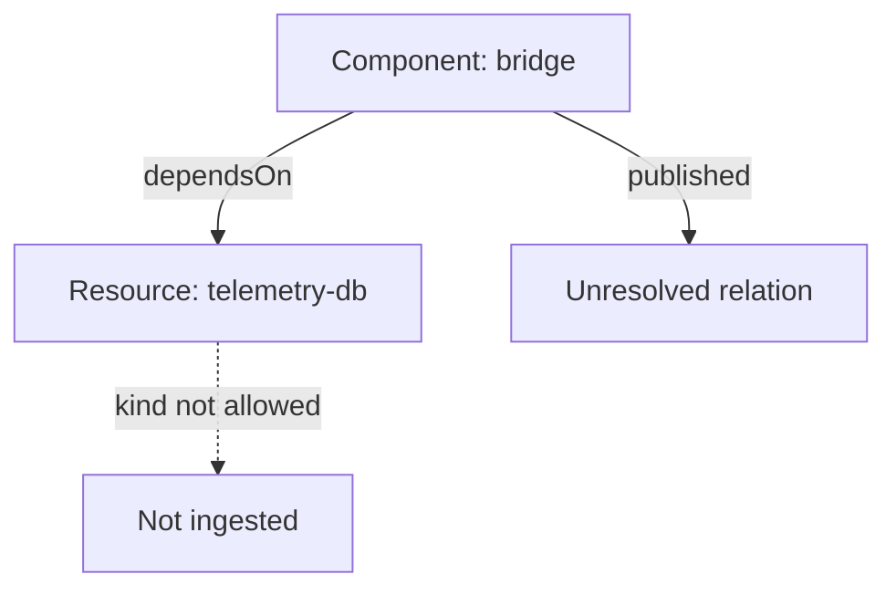

# Validation, Rules, Conflicts And Unresolved Relations

A file that was fetched and parsed can still fail to become a published entity. At this point the catalog knows the entity's text, so every failure has an entity reference and a message that names the rule. Four different things can go wrong here. The entity can break a validation rule, the catalog rules can refuse its kind, a relation can point at nothing, or another location can claim the same identity. Each one shows up in a different part of the evidence, and one of them does not show up in the error list at all.

## Validation: policies and the kind schema

Validation runs in two layers. The entity policies check the envelope that every entity shares: `apiVersion`, `kind`, `metadata`, and the format of the names, labels and annotation keys. The name rule is strict. A `metadata.name` is made of letters, digits and the separators `-`, `_` and `.`, and it has at most 63 characters. A name such as `Probe Service` has a space and fails. Label values follow a similar rule, so `team: Outpost Ops` fails too.

The kind schema checks `spec`. Each kind has required fields. A `Component` needs `spec.type`, `spec.lifecycle` and `spec.owner`. A `Group` needs `spec.type` and `spec.children`, and the list may be empty. A `Resource` needs `type` and `owner`. An `API` needs `type`, `lifecycle`, `owner` and `definition`.

The evidence is an error with the stage `policy` or `kind`, the reference of the entity and a message that quotes the rule. The message is the best guide, because it names the field. An invalid entity is not published. The Backstage documentation says that an entity with an error does not replace the last error-free version, so an older version can stay visible while the new one is rejected.

## Rules: which kinds a location may add

Valid does not mean allowed. The catalog rules, under `catalog.rules`, list the kinds that the catalog accepts. If `catalog.rules` is not set, the default allows `Component`, `System`, `API`, `Resource` and `Location`. It does not allow `Group`, `User` or `Domain`. If the configuration sets `catalog.rules`, that list replaces the default.

A location can add rules of its own. Those rules apply only to entities that the backend read from that exact URL. Entities that a `Location` entity reaches are checked only against the global rules.

A refused entity has a valid body and an error with the stage `rules`. The message says that the kind is not allowed from that location. This error looks like a validation error to a hurried reader, but editing the descriptor cannot fix it. The repair is in the configuration.

## Relations that point at nothing

A relation is derived from a field of `spec`. The `owner` field gives `ownedBy`, `system` gives `partOf`, `providesApis` gives `providesApi`, and `dependsOn` gives `dependsOn`. Two different failures can appear.

The first is a malformed reference. In a field that accepts several kinds, such as `dependsOn`, a reference needs a kind: `resource:default/relay-db`. The text `relay-db` has none, and the processing of the entity fails with a message that says the kind is missing or empty. The error has the stage `relations` and the entity is not published.

The second is a well-formed reference to something that is not there. The entity is valid and is published, and the relation stays open. The report lists it in `.unresolved`. There is no entry in `.errors`, which is why this problem can stay for months. The target may be missing for any of the reasons above: its location was not found, its file did not parse, its kind was not allowed, or nobody wrote it.



The diagram shows that the target of a relation can fail for its own reason while the entity that points at it stays published.

## Identity conflicts

The identity of an entity is its reference: kind, namespace and name. The catalog keeps one entity for each reference. If a second location declares the same reference, the two descriptors compete for it. A copy of a descriptor file into a new repository without changing the name is the usual cause. Two providers or a provider and a static location that discover the same file can also overlap.

In the playground model the first location that claims the reference keeps it. The other document does not become an entity, and the report lists the reference and both locations in `.conflicts`. The losing document adds nothing to `.errors`. If you only read the error list, you can miss the conflict, and you will wonder why the entity of the second repository is missing. In the real backend the evidence is worded differently, so treat the model as an aid for the idea.

The repair is a change of identity at the source. Changing `metadata.title` or the description does nothing, because they are not part of the reference. The descriptor that is wrong gets its own name.

## Stitching and the final entity

After processing, the stitcher merges each entity with the relations that other entities emitted about it. A group page lists the components that it owns for this reason: the `ownedBy` relation was emitted by the component and merged into the group. This means that a broken entity affects other pages. If the group is not ingested, every component that names it as owner has an open relation, and none of the components is wrong.

## Try it: refuse a kind, then duplicate an identity

Renew the playground first.

<!-- astrona:playground:renew -->

Save the configuration without `Resource` in the rules. Save this as `catalog-config.yaml`:

```yaml
apiVersion: v1
kind: ConfigMap
metadata:
  name: catalog-config
  namespace: catalog-source
data:
  app-config.yaml: |
    catalog:
      rules:
        - allow: [Component, System, API, Group, User, Location]
      locations:
        - type: url
          target: https://git.starfleet.example/starfleet-org/blob/main/org.yaml
        - type: url
          target: https://git.starfleet.example/bridge/blob/main/catalog-info.yaml
        - type: url
          target: https://git.starfleet.example/scout/blob/main/catalog-info.yaml
        - type: url
          target: https://git.starfleet.example/probe/blob/main/catalog-info.yaml
```

Apply it:

```sh
kubectl apply -f catalog-config.yaml
```

Then print the rules error and the open relation:

```sh
inspect_catalog -c '.errors[] | select(.stage == "rules")'
inspect_catalog -c '.unresolved[]'
```

The `telemetry-db` Resource has a valid body and is refused with the stage `rules`. The Component `bridge` is still ingested, and its `dependsOn` relation appears in `.unresolved`. Restore `Resource` in the list and apply the file again.

Now declare a second Component named `bridge` in the `scout` repository. Save this as `repo-scout.yaml`:

```yaml
apiVersion: v1
kind: ConfigMap
metadata:
  name: repo-scout
  namespace: catalog-source
data:
  catalog-info.yaml: |
    apiVersion: backstage.io/v1alpha1
    kind: Component
    metadata:
      name: bridge
      description: Copied by mistake
    spec:
      type: website
      lifecycle: production
      owner: scout-team
```

Apply it and print the conflicts and the errors:

```sh
kubectl apply -f repo-scout.yaml
inspect_catalog -c '.conflicts'
inspect_catalog -c '.errors | length'
```

The conflict lists `component:default/bridge` with the two locations, and the `bridge` repository comes first because its location comes first in the configuration. The number of errors did not grow. The `scout` entity is gone from the ingested list, and only the conflict list explains why. Rename the duplicate back to `scout` to repair it.

You can now place any failure in its step and know where its evidence is. What remains is to use that order on an estate with several faults at once.

## Common pitfalls

> [!WARNING]
> Do not change the description or the title to resolve a conflict: only the kind, the namespace and the name make up the identity. Do not search the error list alone: unresolved relations and conflicts have their own lists. Do not add a kind to the rules just because an error mentions rules without first asking whether a location should be allowed to add that kind.
