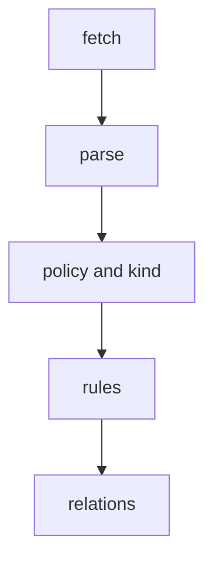

# A Triage Routine For Ingestion Errors

When an entity is missing from the catalog, a person usually changes things at random: edits the file, registers the location again, restarts the backend. Each change adds noise. A better habit is to read the errors in the order of the processing stages, fix the earliest one and read again. This part gives that routine and shows why the order matters.

## Why the order matters

An entity passes through the stages in a fixed order: fetch, parse, validation by the entity policies, validation by the kind schema, the rules for allowed kinds and the relations. A failure at one stage stops the later stages for that file or document. A parse error means that no entity from that document reaches the policies. A policy error means that the rules and the relations are never checked for it.

The consequence is that a list of errors is only the first layer. Fixing the first error can show a second one at a later stage. This is normal progress, not a new fault. The policies also stop at their first failure, so one document can show a new validation error each time you fix the previous one.



The diagram shows the order in which to read the errors and the order in which they appear after each fix.

## The routine

Start with the numbers. How many locations were read, and how many are not `ok`? How many errors are there, and at which stages? Then take the earliest stage that has an error, fix one thing and read the report again. Check `.conflicts` and `.unresolved` at the end, because they hold problems that produce no error line.

<!-- astrona:playground:renew -->

Paste the helper function once:

```sh
inspect_catalog() {
  kubectl -n catalog-source get configmap -o json | kubectl -n catalog-tools exec -i deploy/catalog-tools -- node /opt/check/inspect.js | jq "$@"
}
```

Count the errors by stage:

```sh
inspect_catalog -c '.errors | group_by(.stage) | map({stage: .[0].stage, count: length})'
```

The playground estate has a fault in `probe`, and the list shows the stage of that fault. Print the locations that are not `ok`, the conflicts and the unresolved relations together:

```sh
inspect_catalog -c '{badLocations: [.locations[] | select(.status != "ok") | .target], conflicts: .conflicts, unresolved: .unresolved}'
```

Now make a second fault in front of the first. Change the location of `scout` in `catalog-config` from `blob/main/` to `blob/master/`. Save the full ConfigMap, edit it and apply it:

```sh
kubectl -n catalog-source get configmap catalog-config -o yaml > catalog-config.yaml
kubectl apply -f catalog-config.yaml
```

Read the grouped errors again:

```sh
inspect_catalog -c '.errors | group_by(.stage) | map({stage: .[0].stage, count: length})'
```

A new item for the stage `fetch` appears. The `scout` file was never read, so any later error in that file is hidden. This is the reason to fix the earliest stage first. Change the branch back to `main`, apply the file again and read the report.

## Read the error, then the entity

The error line says the stage and the message. The entity record says more. Print the record of `probe`:

```sh
inspect_catalog -c '.entities[] | select(.declared == "component:default/probe") | {valid, allowed, ingested, errors}'
```

The fields `valid` and `allowed` show which check failed, and `ingested` is the final result. An entity with `valid: true` and `allowed: false` points at the rules, not at the file. An entity with `valid: false` points at the file. The message names the property, so repair exactly that property and read the report again.

## What you now know

You can read the errors by stage, explain why one fix reveals another error and use the three extra lists for the problems that produce no error line. The open question is what the real catalog adds on top of this report, such as logs and the processing status on the entity page, which a model cannot show.

## Common pitfalls

> [!WARNING]
> Fix the earliest failing stage first. An empty error list does not mean the catalog is healthy: conflicts and unresolved relations have their own lists. Registering the location again does not repair a file. Restarting the backend does not repair a validation error.
