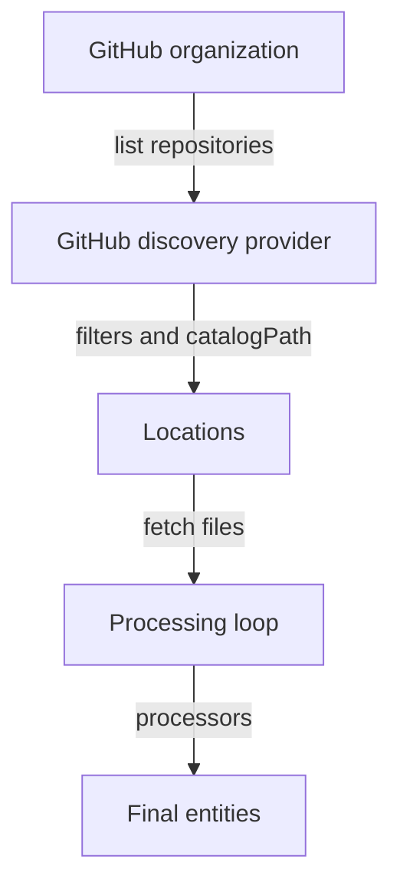

# Entity Providers And GitHub Discovery

A catalog that depends on people registering every repository by hand is always behind. New services appear, old ones move, and nobody remembers to add the file. Automated ingestion solves this by letting code find the descriptor files and feed them into the catalog. This part explains the two kinds of code that take part in ingestion, shows what a GitHub discovery provider is, and reads a real provider configuration in the playground.

## Providers and processors do different work

Backstage splits ingestion into two roles. An entity provider is the original source of entities. It decides when to fetch data and what to hand to the catalog. A processor runs later, inside the processing loop of the catalog backend. It reads an entity that already exists in the catalog and can validate it, add annotations, emit relations or read a custom location type.

The difference is the direction of the work. A provider creates input for the catalog. A processor works on input that the catalog already holds. Without a provider, no entity enters the system. Without processors, the entities enter but nothing validates them or derives their relations.

Each provider has a name. The name must be unique across all providers and stable over time, because the catalog backend stores the entities of one provider together under that name. If a provider changes its name, the backend sees a new provider and treats the old entities as belonging to a provider that no longer exists.

## How GitHub discovery works

GitHub discovery is an entity provider that comes in the package `@backstage/plugin-catalog-backend-module-github`. The package is not installed by default. A Backstage administrator adds it to the backend with `backend.add(import('@backstage/plugin-catalog-backend-module-github'))`. After that, the provider reads its settings from the `catalog.providers.github` section of the application configuration.

Each entry below `github` is one provider and its key is the provider id, any camelCase string. An entry names the GitHub `organization` to scan, the `catalogPath` of the descriptor file inside every repository and a list of `filters`. The default `catalogPath` is `/catalog-info.yaml`. The `schedule` says how often the provider runs.

On every run the provider lists the repositories of the organization, removes the ones that fail a filter and builds one location for each remaining repository. The location points at the descriptor file on the branch that the filters select. The catalog backend then fetches the file like any other location and processes the entities in it. That is why a discovered entity carries the annotation `backstage.io/managed-by-location`, the same as an entity from a static location.



The diagram shows that the provider only produces locations, and that the processing loop does the validation and the relations afterwards.

## What the playground models

The playground does not run Backstage and does not contact GitHub. A pod in the cluster reads the descriptor files from ConfigMaps and applies the provider settings in the way described above. Each ConfigMap named `repo-<name>` in the namespace `catalog-source` stands for one repository of the organization `starfleet`. The annotations of the ConfigMap stand for what GitHub knows about the repository: its topics, its visibility and its default branch. The configuration is the ConfigMap `catalog-config` with the key `app-config.yaml`.

The model uses the real `@backstage/catalog-model` library to validate each entity. The provider, the locations and the schedule are simplified. The model never runs a timer and never uses a credential. Keep that limit in mind when you read the output.

<!-- astrona:playground:renew -->

Paste the helper that prints the report of the model. It sends every ConfigMap of `catalog-source` to the pod `catalog-tools` and passes your arguments to `jq`:

```sh
inspect_catalog() {
  kubectl -n catalog-source get configmap -o json | kubectl -n catalog-tools exec -i deploy/catalog-tools -- node /opt/check/inspect.js | jq "$@"
}
```

Print the provider configuration that the model parsed:

```sh
inspect_catalog '.config.providers.github'
```

The output shows one provider with the id `starfleetServices`. It scans the organization `starfleet`, reads `/catalog-info.yaml` and filters by branch, topic and visibility. The `schedule` holds a frequency of 30 minutes and a timeout of 3 minutes.

## Follow the provider to its locations

The report lists every location with its `origin`. A location from the static configuration has the origin `config`. A location that the provider built has an origin of the form `provider:github:<id>`. List only the discovered ones:

```sh
inspect_catalog -c '[.locations[] | select(.origin | startswith("provider")) | {target, status}]'
```

Three locations appear, for `bridge`, `scout` and `shuttle`. Each target has the form `https://git.starfleet.example/<repository>/blob/main/catalog-info.yaml`, and each status is `ok`. Eight repositories exist, so five were removed by filters.

The same report lists the entities that reached the catalog:

```sh
inspect_catalog '.summary.ingested'
```

The list holds the three Components found by the provider and the teams that arrive through a static location for the organization file. Nobody registered `bridge`, `scout` or `shuttle`. The provider found them.

## Why the split matters when something is missing

When an expected entity is missing, the first question is which role failed. If the provider did not build a location, the cause is in the provider configuration: the organization, a filter or the path. If the location exists but the entity is missing, the cause is in processing: a validation error, a rule that blocks the kind or a conflict. The report keeps the two apart. `.locations` shows what the provider produced and `.errors` shows what processing rejected.

A healthy provider run does not prove healthy data. A provider can report success while one descriptor fails validation. In the other direction, processors can be healthy while the provider found no repository, and then the catalog quietly goes out of date.

Providers also decide how they send updates. One provider replaces the whole set it owns on each run. Another provider sends only the changes it sees. Both ways exist, and each has its own risk when a run is incomplete.

You now know what a provider is, how GitHub discovery turns a configuration into locations, and where to look to tell a provider problem from a processing problem. The open question is how the filters decide which repositories are in scope.

## Common pitfalls

> [!WARNING]
> Do not treat a provider and a processor as the same thing: a provider creates input, a processor works on input that exists. A missing entity does not always mean a broken provider; check `.locations` first and `.errors` second. Changing the provider id makes the backend see a new provider.
