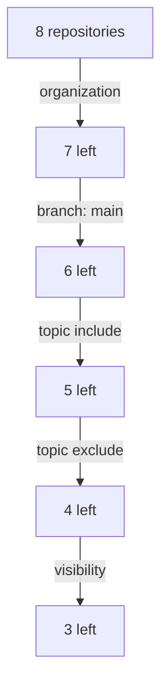

# Discovery Filters, Scope And Credentials

Discovery gives the catalog everything that a provider is allowed to see, so the filters decide what the catalog contains. A filter that is too wide publishes repositories that should stay private or are not production services. A filter that is too narrow leaves services out and nobody notices. This part explains each filter of the GitHub discovery provider, the order in which they apply, and the credential that sits behind them.

## The filters of the GitHub provider

The filters live under `filters` in the provider entry. A repository must pass every filter that is set. A filter that is not set does not restrict anything.

- `repository` is a regular expression that is tested against the repository name. `'^(?!sandbox-)'` rejects every name that starts with `sandbox-`.
- `branch` is the branch that the provider reads. If it is not set, the provider uses the default branch of each repository. A branch name cannot contain a slash.
- `topic.include` is a list. A repository passes when it has at least one of the topics.
- `topic.exclude` is a list. A repository fails when it has any of the topics. Exclusion wins over inclusion.
- `visibility` is a list of `public`, `internal` and `private`.
- `allowArchived` decides whether archived repositories are included. The default is `false`.

The provider entry has two more settings that act as filters. `organization` limits the scan to one GitHub organization, and one provider entry covers one organization. `catalogPath` says which file to read. The default is `/catalog-info.yaml`. The value can also be a glob such as `/groups/**/*.yaml`, which finds several files in one repository.

## An example with eight repositories

The organization `starfleet` has eight repositories. The provider asks for the branch `main`, the topic `catalog`, no topic `experiment` and the visibility `public` or `internal`. Five repositories fail:

- `starfleet-org` has the topic `org` and not `catalog`.
- `probe` has the topic `experiment`, which the exclusion removes even though `catalog` is also present.
- `vault` is `private`.
- `hangar-legacy` has the default branch `master`.
- `outpost-relay` belongs to another organization.

The remaining three repositories, `bridge`, `scout` and `shuttle`, pass, and the provider builds a location for each. Notice that every failing repository fails for a different reason, and that one filter is enough to remove it.



The diagram shows the effect of the filters one after the other; the real provider applies all of them to each repository, so the order does not change the result.

<!-- astrona:playground:renew -->

In the playground, the facts that GitHub would report are annotations of the ConfigMaps. Print them for all repositories:

```sh
kubectl -n catalog-source get configmap -o json | jq -r '.items[] | select(.metadata.name | startswith("repo-")) | [.metadata.name, .metadata.annotations["astrona.io/topics"], .metadata.annotations["astrona.io/visibility"], .metadata.annotations["astrona.io/default-branch"], .metadata.annotations["astrona.io/organization"]] | @tsv'
```

One line per repository appears. Compare each line with the filters and name the filter that removes `vault`.

Change the facts instead of the filters. Make `vault` an internal repository by changing its visibility annotation:

```sh
kubectl -n catalog-source annotate configmap repo-vault astrona.io/visibility=internal --overwrite
```

Then ask the report whether the signing service is now in the catalog:

```sh
inspect_catalog '.summary.ingested | index("component:default/vault") != null'
```

The output is `true`. Nobody edited a descriptor or the provider configuration. A change in the repository metadata was enough. This is the main risk of automatic scope: the catalog follows the repository, so a topic or a visibility change at the source changes the catalog.

Set the annotation back:

```sh
kubectl -n catalog-source annotate configmap repo-vault astrona.io/visibility=private --overwrite
```

## Scope is also an ownership decision

A provider owns the entities it creates. When a filter widens, the catalog gains entities that no team asked for. When a filter narrows, the entities of the removed repositories stop being provided, and the catalog backend can delete them. Neither change is harmless. Review a filter change like a change to production configuration.

A narrow filter on purpose is a good default. Start with a topic such as `catalog` that a team adds to a repository when it is ready, instead of a regular expression that takes everything. A topic is an opt-in that the owner of the repository controls.

## Credentials stay on the server

The provider needs permission to read the repositories and their files. GitHub accepts a personal access token with at least the `repo` scope, or a GitHub App with at least the permission `Contents: Read-only`. The credential belongs in the protected configuration of the Backstage backend, under `integrations.github`, and never in a descriptor, a label or an annotation.

Too little permission makes repositories invisible to the provider, and they are missing without a clear error. Too much permission lets the provider read repositories that the filters then have to exclude. A filter limits what enters the catalog, but the credential limits what the backend can read at all. Give the credential the smallest scope that still covers the organization.

The labs in this course never use a token. The model does not call GitHub, so it only shows the effect of the filters.

## Common pitfalls

> [!WARNING]
> A topic in `topic.exclude` always wins over the same topic in `topic.include`. A regular expression in `repository` matches part of a name unless you anchor it with `^` and `$`. Provider filters read repository metadata, so a change on GitHub changes the catalog without any change in the configuration. Never place a token in a descriptor or an annotation.
