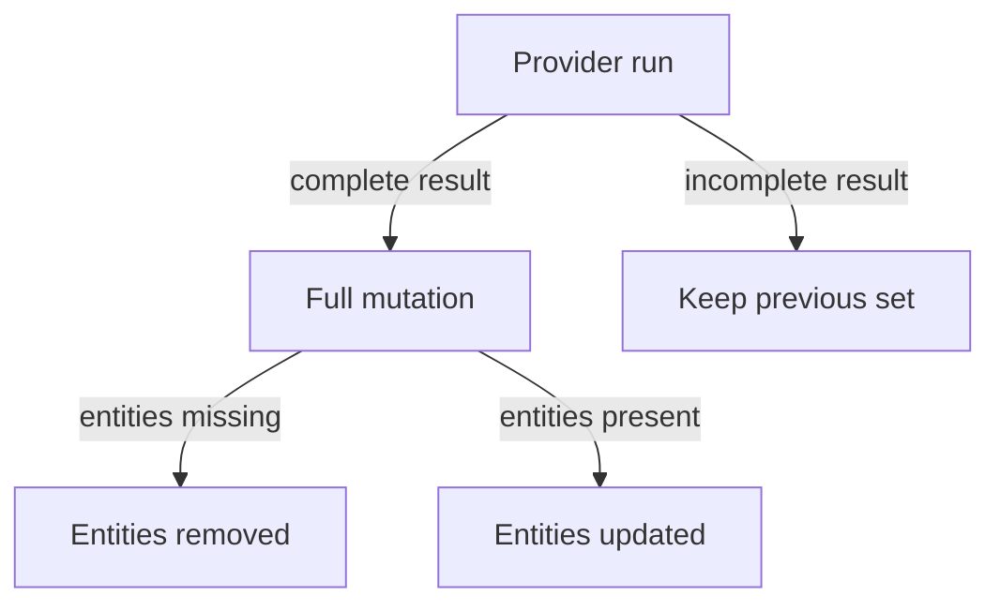

# Schedules, Updates And Overlapping Sources

A provider is a repeating job. It runs on a schedule, sends its result to the catalog and leaves the catalog to decide what to keep. Three questions follow from that. How often does it run and what does that cost? What happens to an entity when a run returns less than before? What happens when two sources describe the same entity? This part answers them and shows the last one in the playground.

## The schedule

The `schedule` of a GitHub discovery provider has a `frequency` and a `timeout`. It can also have an `initialDelay` and a `scope`. The frequency says how often the task starts. The timeout is the longest time that one run may take. The initial delay postpones the first run after the backend starts. The scope is `global` or `local` and controls whether the run is coordinated across several backend instances. A value can be an ISO duration, a human duration or a cron expression. The examples in this course use an object such as `{ minutes: 30 }`.

The frequency is a trade between freshness and load. A short frequency finds a new descriptor quickly. It also sends many requests to GitHub. The provider makes one API request for each discovered location on every refresh. GitHub allows 5,000 requests per hour for a normal token, and the same limit is shared with every other tool that uses the token. A frequency of 20 seconds with 100 repositories would need 18,000 requests per hour. The provider would hit the limit, and later runs would fail.

A long frequency saves requests and delays every change. The backend can also react to events. The GitHub module subscribes to the events `github.push` and `github.repository`, which arrive through the events service. A push event lets the catalog refresh a location when someone changes a descriptor, without waiting for the next run. Events only shorten the delay. A missed event must still be repaired by the next scheduled run, so the schedule is never optional.

## Full and delta updates

A provider sends its result to the catalog as a mutation. There are two kinds. A full mutation replaces everything the provider owns. Entities that the provider leaves out of the list disappear from its set. A delta mutation upserts or deletes named entities and leaves the rest alone.

Both are correct when the provider knows what it is doing. The risk sits in the full mutation. If a run is cut short, for example by a timeout or a failed page request, and the provider still sends the partial list as a full mutation, the catalog treats every missing entity as removed. A temporary failure turns into deletion. A good provider reports the failed run and keeps the previous set.



The diagram shows that a full mutation is only safe when the run was complete, because everything that is missing from it is removed.

The catalog backend adds one more rule. By default, entities of a provider that is no longer configured are removed, and entities that no source emits any more become orphans that the backend removes. The settings `catalog.orphanProviderStrategy` and `catalog.orphanStrategy` with the value `keep` turn that clean-up off. Decide on purpose whether the catalog should delete or keep what automation stops providing.

## Two sources for one entity

A provider owns its entities, and no two providers can safely emit the same entity. The backend records for each entity a location key, and a new entity with the same reference only replaces the stored one when the keys match. If they do not match, the catalog rejects the second entity and reports a conflict.

A conflict is easy to create by accident during a migration. The team keeps a static location from the old setup and turns on discovery. Both read a descriptor that declares the same Component. Which source wins depends on which one was processed first, so the result can change after a restart. Decide that one source owns an entity and remove the other.

A static location that points at exactly the same file as the provider is also a duplicate source. The playground model reads such a location only once, but do not rely on that. When the discovery provider is the source of truth, a static location only adds a second place where the two can drift apart.

<!-- astrona:playground:renew -->

In the playground the provider reads the file `catalog-info.yaml`, and the repository `scout` also holds a second file `legacy-info.yaml` that declares the same Component. Paste the helper if your terminal is new:

```sh
inspect_catalog() {
  kubectl -n catalog-source get configmap -o json | kubectl -n catalog-tools exec -i deploy/catalog-tools -- node /opt/check/inspect.js | jq "$@"
}
```

Save the current catalog configuration to a file:

```sh
kubectl -n catalog-source get configmap catalog-config -o jsonpath='{.data.app-config\.yaml}' > app-config.yaml
```

Open `app-config.yaml` and add a second static location under `locations`, below the one for the organization file:

```yaml
    - type: url
      target: https://git.starfleet.example/scout/blob/main/legacy-info.yaml
```

Apply the changed file:

```sh
kubectl -n catalog-source create configmap catalog-config --from-file=app-config.yaml --dry-run=client -o yaml | kubectl apply -f -
```

Then read the conflicts:

```sh
inspect_catalog '.conflicts'
```

The report lists the entity `component:default/scout` with the two locations that claim it, one for `legacy-info.yaml` and one for `catalog-info.yaml`. The location read first keeps the entity in this model, and it is the static one. The provider copy is not ingested. Remove the added location from `app-config.yaml`, apply the file again, and the conflict list is empty.

## Removal is a decision, not an accident

The scope of a provider is a rule about what should exist in the catalog. When a repository fails a filter, for example because someone made it private, the provider stops returning its location, and the entities can leave the catalog. This is right when the service is gone, and wrong when only a permission or a token changed. Before you trust automatic removal, check how a missing repository is told apart from a deleted one, and whether you want the catalog to keep orphans.

You now know that the schedule sets freshness and request load, that a full mutation removes what a run leaves out, and that an entity needs exactly one owner source. Together with the filters, this lets you judge whether a discovery setup is safe.

## Common pitfalls

> [!WARNING]
> A short frequency can use up the GitHub rate limit that other tools share. A timeout is not a retry: a run that times out must not be treated as a complete list. A static location and a provider that read different files with the same entity cause a conflict, and changing a title does not fix it. Events shorten the delay but do not replace the schedule.
