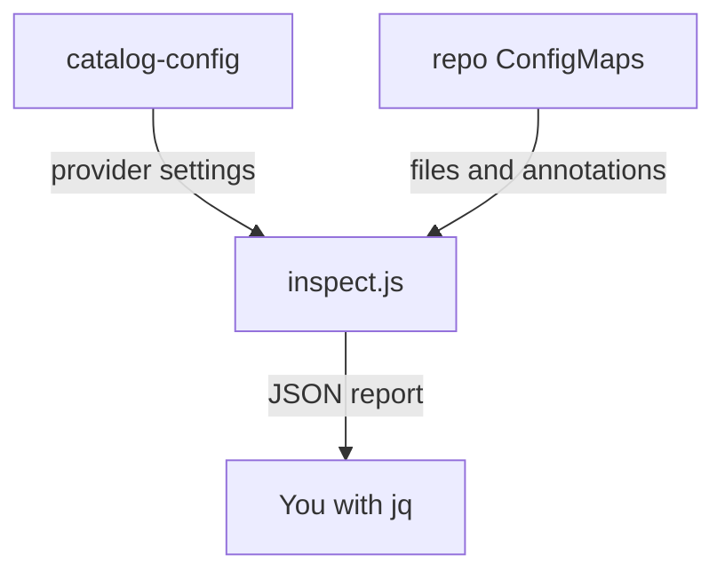

# Entity Providers, Discovery Scope And Repeatable Ingestion

This module teaches how the Backstage catalog fills itself without manual registration. An entity provider finds descriptor files in a source system and hands them to the catalog on a schedule. You learn what a provider does, how GitHub discovery decides which repositories are in scope, and what happens when a run is incomplete or when two sources describe the same entity. You practise on a model of the catalog backend in a playground that you can change and read back.

## Learning Goals

- Explain entity providers and processors as distinct ingestion roles.
- Read a `catalog.providers.github` configuration and predict which repositories it discovers.
- Use `organization`, `catalogPath`, `branch`, `repository`, `topic` and `visibility` filters to set the scope.
- Reason about the schedule, full and delta mutations, and the effect of an incomplete run.
- Recognise duplicate sources and the ownership and credential risks of automated discovery.

## Learning Objectives

After this module you can:

1. State what an entity provider and a processor each do, and which one fails when a location is missing.
2. Write a GitHub discovery provider entry with a path, filters and a schedule.
3. Explain why a change to a repository topic, visibility or default branch changes the catalog.
4. Choose a schedule that balances freshness and the GitHub rate limit.
5. Explain how a full mutation can remove entities after a failed run.
6. Find and remove a duplicate between a provider and a static location.

## What You Should Know First

You should know that the catalog holds entities described in YAML descriptor files, that a descriptor has `apiVersion`, `kind`, `metadata` and `spec`, and that a location tells the catalog where a descriptor file lives. You should know that `catalog.rules` limits the kinds of entities that a location may add. You do not need to know any Backstage code.

## What the Playground Is

The playground is a single-node kind cluster. It does not run Backstage. It runs a model of the catalog backend that reads the descriptor files, validates them with the real `@backstage/catalog-model` library, and applies the locations, the rules and the GitHub discovery providers.

The environment has these parts:

- Eight ConfigMaps named `repo-<name>` in the namespace `catalog-source`. Each one stands for a repository of the GitHub organization `starfleet`. Each data key is a file in that repository.
- The annotations of a repository ConfigMap carry the facts that GitHub reports: topics, visibility, default branch and organization.
- The ConfigMap `catalog-config` with the key `app-config.yaml`. It holds the `catalog:` section of the Backstage configuration, including `providers.github.starfleetServices`.
- The deployment `catalog-tools` in the namespace `catalog-tools`. It runs `node /opt/check/inspect.js`, which reads the ConfigMaps and prints one JSON report.

The model has limits that you must remember. It never contacts GitHub and it uses no credential. It does not run the schedule, so it cannot show a run that fails halfway. It shows what a provider configuration discovers and what the catalog does with the result.



The diagram shows that the report is computed from two inputs, the configuration and the repository ConfigMaps, and that you read the result with `jq`.

## The Report You Will Read

The helper function below sends the ConfigMaps to the pod and passes your arguments to `jq`. Each lesson repeats it where it is needed.

```sh
inspect_catalog() {
  kubectl -n catalog-source get configmap -o json | kubectl -n catalog-tools exec -i deploy/catalog-tools -- node /opt/check/inspect.js | jq "$@"
}
```

These parts of the report are used throughout the module:

- `.config` is the parsed `catalog:` section.
- `.locations[]` lists each location with its `origin`, `target` and `status`. The origin `provider:github:<id>` marks a discovered location.
- `.entities[]` lists each entity with `valid`, `allowed`, `errors` and `ingested`.
- `.errors[]`, `.conflicts[]` and `.unresolved[]` list what went wrong.
- `.summary.ingested` lists the entities that entered the catalog.

## How the Module Is Organised

The module has three lessons, a summary, a graded lab and a capstone lab with a quiz at the end.

The first lesson explains providers and processors and reads a provider configuration. The second lesson explains the filters and the credential that sit behind them, and ends with a graded lab in which you repair a provider. The third lesson covers the schedule, full and delta updates and duplicate sources. The summary closes the module. The capstone combines everything in one estate.

## How to Work Through a Lesson

Read the lesson once, then run the commands in the order they appear. Each lesson tells you in plain words what a command should show, so you can compare your result with the text.

Keep the report open while you change the configuration. The report is the evidence for every claim in this module. When a result surprises you, print the part of the report that explains it before you change anything else.

Each lesson has one idea. The graded labs start from a state that contains faults, so work from the report to the cause and not from a guess.

## What Is Not Covered

The module does not write a custom entity provider in TypeScript. It does not set up a GitHub App or a token, because the labs must never hold a credential. It does not cover other providers, such as the ones for GitLab, Bitbucket or LDAP. The ideas about scope, schedules and ownership apply to all of them in the same way.

## Status of the Labs

The playground and both labs were built with static checks only. Nobody has run them on a real cluster yet. If a command does not behave as the page says, treat it as a bug in the material and report it.

<!-- astrona:playground -->
